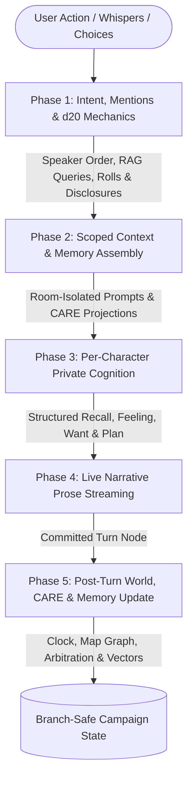

# Vision & Philosophy: The CyberCantina Paradigm

> *"Prose is merely the rendering layer of an unfolding reality. The moment you mistake the narrative transcript for the state of the world, your simulation collapses."*

---

## 1. Executive Summary & The Core Problem

For years, the AI roleplay ecosystem has been dominated by interfaces that treat Large Language Models as **stateless text-completion buffers**. Across conventional chat frontends and proprietary roleplay platforms, the underlying loop looks largely the same:

- A flat transcript of alternating user and assistant messages is fed back into the prompt.
- World state—inventories, character locations, passage of time, injuries, and evolving relationships—exists only as fragile words inside recent prose.
- Multi-character scenes force a single generation pass into improvised multi-character puppetry, blending voices, awareness, and physical actions together.
- Context windows act like unsorted scrapbooks: every turn shifts dynamic state around the prompt, invalidating local inference prefix caches and slowing down generation.
- Swiping a response or branching a story risks silently desynchronizing what actually happened from what characters think they remember.

**CyberCantina exists to change that paradigm.**

CyberCantina is not a chat wrapper or prompt aggregator. It is a **stateful, multi-actor cognitive simulation engine** that brings together local-first AI inference, tabletop RPG structure, and branch-safe world persistence.

---

## 2. Foundational Principles

CyberCantina's design rests on six core ideas:

### I. Prose Is a Projection, Not the State
In a chat-only setup, if a character writes *"Marcus hands you the iron key,"* that key exists only as passing text. Once the scene scrolls out of context—or the next reply forgets it—the key vanishes.

In CyberCantina:
- **World state is authoritative, structured, and branch-safe.**
- Items have verified custody, ownership locks, and provenance.
- Locations form an interconnected spatial graph with real passages and travel times.
- Time advances deterministically through a shared world clock.
- Narrative prose is the literary **projection** of that underlying world state—never the sole place where truth lives.

### II. Cognition & Emotion Precede Expression
People do not generate replies as raw word completions; they notice what happened, feel something about it, decide what they want, choose how guarded to be, and *only then* speak or act.

In CyberCantina:
- **Private Cognition Before Prose:** Before any dialogue is narrated, each character present in a scene runs a separate internal reasoning step covering memory recall, emotional appraisal, immediate desire, and an actionable plan.
- **Masking & Interiority:** Inner thoughts are decoupled from spoken words—a composed character can feel threatened or bitter internally while projecting calm professionalism outward.
- **Persistent Psychology & Relationships (CARE):** Through the CyberCantina Affective & Relational Engine (**CARE**), moods decay naturally over in-world minutes, severe shocks strain composure, and long-term bonds of warmth, trust, and grievance carry forward across scenes. For how this works under the hood, see [Architecture: CARE Affective Engine](https://github.com/diegolima/CyberCantina/wiki/Architecture-CARE-Affective-Engine).

### III. Strict Information Boundaries
Characters should only know what they could plausibly perceive. If one character is down in a cellar, they should have zero awareness of a quiet conversation happening upstairs.

CyberCantina enforces strict privacy boundaries across both space and identity:
- **Room-Level Separation:** Working memory and scene awareness are filtered by physical room presence; off-site characters are unaffected unless contacted directly via remote comms.
- **Private Whispers:** Sensory cues and directed lines addressed to one character remain invisible to bystanders in the same room and are scrubbed from shared story summaries.
- **Player Secrets & Gossip:** Characters only learn hidden details about your persona when you reveal them in person or when a witness later shares them in prose.

### IV. Hardware Sympathy & Prefix Stability
In local model runtimes, prompt evaluation speed depends heavily on preserving the model's Key-Value (KV) cache across consecutive turns. Mutating information near the top of a prompt forces the engine to recompute thousands of tokens from scratch.

CyberCantina keeps unchanging character identities, world rules, and older story summaries anchored at the front of the prompt while pushing volatile per-turn inputs—the clock, room exits, dice outcomes, recalled memories, and active emotional cues—strictly to the tail. This keeps local inference responsive even in long campaigns, and pairs naturally with splitting prose generation (**Actor**) from lightweight background reasoning (**Clerk**). See [Architecture: Context, Memory & State](https://github.com/diegolima/CyberCantina/wiki/Architecture-Context-Memory-and-State) for the exact layout.

### V. Branch-Safe Multiverses
Interactive storytelling thrives on *"what if"* exploration: *"What if I refused the deal instead of playing along?"*

- CyberCantina stores every campaign as an acyclic **Turn Tree** rather than a single linear chat history.
- World timestamps, character positions, discovered rooms, inventories, emotional coordinates, episodic summaries, and recalled memories are all anchored cleanly to turn lineage.
- Swiping, editing earlier turns, or jumping across timeline branches restores the exact world and psychological state for that branch—with zero cross-branch contamination.

### VI. Deterministic Mechanics Over Hallucinated Outcomes
When a character tries to breach a terminal, bluff a guard, or seize a contested artifact, narrative pacing suffers if the model simply decides everything succeeds—or loses track of who holds what.

CyberCantina pairs LLM storytelling with grounded arbitration:
- **Tabletop `d20` Resolution:** Risky actions trigger structured rolls evaluated across five outcome tiers—**Critical Failure**, **Failure with Consequences**, **Simple Failure**, **Clean Success**, and **Critical Success**—as well as gated **Director Choices** to guide pacing without taking over character voice.
- **Post-Turn Clerks & Item Arbitration:** After each reply, background agents reconcile world changes, track room movement (including newly improvised rooms), and referee disputed item transfers while respecting permanent item locks.

---

## 3. The 5-Phase Turn Flow

Every turn moves through a clear, inspectable five-stage pipeline:

1. **Pre-Analysis & Mechanics:** Decomposes public actions vs. private `@Character:` whispers, detects revealed persona secrets, resolves speaker order, and executes any required `d20` checks or Director Choice gates.
2. **Scoped Context Assembly:** Gathers room-filtered working memory, episodic summaries, hybrid semantic memory recalls, and qualitative CARE projections while keeping prompt prefixes stable.
3. **Character Cognition:** Runs private cognitive reasoning for each present character (sequentially by default for single-GPU setups, or concurrently on multi-slot backends).
4. **Prose Streaming:** Streams literary narrative from the Actor model guided by established character plans, voice anchors, and resolved roll outcomes.
5. **Post-Turn Clerk & State Sync:** Advances the world clock, updates scene flags and room graphs, arbitrates inventory changes, commits CARE emotional/relational updates, and indexes new memories and summaries for future recall.

For a deeper technical breakdown, see [Architecture: 5-Phase Turn Pipeline](https://github.com/diegolima/CyberCantina/wiki/Architecture-Turn-Pipeline).

---

## 4. Engineering Approach & Where We Are Going

CyberCantina is built for people who care equally about storytelling craft and systems design: **local-first**, **provider-agnostic** (supporting local servers, cloud providers, hybrid Actor/Clerk pairings, and full offline heuristic testing without a GPU), and **verifiable** through automated branch-safety and state-integrity tests.

Details on the stack, test commands, and module layout live in the [Developer Guide & Roadmap](https://github.com/diegolima/CyberCantina/wiki/Developer-Guide-and-Roadmap). Looking ahead, key open frontiers include:

1. **Autonomous World & Social Simulation:**
   - Off-screen character routines and movement across locations while the player is away.
   - Dynamic faction reputation and rumor propagation across spatial graph edges.
2. **Deeper Memory & Reflection:**
   - Graph-RAG links connecting character relationships, lore, and episodic clusters.
   - Sleep/reflection consolidation cycles and adaptive memory salience over time.
3. **Simulation Integrity & Extensible Mechanics:**
   - Pre-prose affordance verification to catch hallucinated items or tools between character planning and narrative generation.
   - Pluggable tabletop mechanics (alternative dice systems, conditions, progression, and item properties).
4. **Runtime & Data Sovereignty Hardening:**
   - Database-level encryption at rest and zero-knowledge client-side encrypted campaign backups.
   - Deeper integration with local inference engines for branch-aware KV-cache snapshotting.

---

## 5. Philosophy on Open Source & Community

### Copyleft Reciprocity (`AGPL-3.0-or-later`)
CyberCantina is licensed under the **GNU Affero General Public License v3.0 or later**. Anyone is free to self-host, modify, or operate CyberCantina commercially as a service—the copyleft guarantee simply ensures that anyone distributing or running a modified version over a network shares their improvements back with the community.

### User Privacy & Data Sovereignty
Personal storytelling and roleplay are deeply private. CyberCantina is built around **ownership of your own data**:
- **Self-hosted control:** Your worlds, characters, campaigns, and memories live on hardware you choose, with optional local passwordless mode, multi-user isolation, Passkeys, and Bring Your Own Provider (BYOP) controls.
- **Zero upstream surveillance:** The codebase includes no covert tracking, dark patterns, or forced telemetry.
- **Strict opt-in diagnostics:** Any future upstream diagnostic metrics must remain strictly opt-in (default off), transparent, and never touch stories, prompts, or personal data.

### Engineering Rigor
We value clear boundaries, explicit schemas, and automated tests over brittle shortcuts. Changes to turn execution, memory isolation, or psychological state belong alongside tests verifying branch safety and data integrity.

---

## 6. Getting Started

* New to CyberCantina? Follow the Quick Start in [README.md](README.md).
* Want to browse guides or deep technical docs? Visit the [CyberCantina Wiki](https://github.com/diegolima/CyberCantina/wiki).
* Interested in contributing? Check out the [Developer Guide & Roadmap](https://github.com/diegolima/CyberCantina/wiki/Developer-Guide-and-Roadmap) and open an issue or pull request.

*Welcome to the Cantina. Let's build something unforgettable.*
