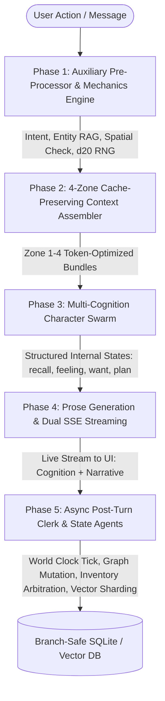

# Vision & Philosophy: The CyberCantina Paradigm

> *"Prose is merely the rendering layer of an unfolding reality. The moment you mistake the narrative transcript for the state of the world, your simulation collapses."*

---

## 1. Executive Summary & The Core Problem

For years, the open-source AI roleplay ecosystem has been dominated by frontends that treat Large Language Models as **stateless text-completion buffers**. Whether in SillyTavern, generic chat UIs, or proprietary chat platforms, the prevailing paradigm is fundamentally identical:
- A flat transcript of alternating user and assistant messages is stuffed into context.
- World state (inventories, character locations, passage of time, wounds, relational rapport) exists solely as ephemeral tokens inside the narrative prose.
- Multi-character scenes force a single model into "schizophrenic puppetry," hallucinating dialogue, reactions, and physical movements for multiple agents in one undifferentiated shot.
- Context windows are treated as dump sites: every turn reshuffles volatile dynamic data across the prompt, constantly evicting and busting the LLM's Key-Value (KV) cache.
- Swiping a turn or branching a timeline risks irrevocably desynchronizing what happened from what the character remembers.

**CyberCantina exists to break this paradigm.**

CyberCantina is not another chat skin or prompt aggregator. It is an **agentic, multi-actor cognitive simulation engine** that bridges modern local AI inference with the rigorous state mechanics of tabletop roleplaying games (TTRPGs) and distributed multi-agent systems.

---

## 2. Foundational Architectural Principles

Our design philosophy is anchored in six foundational tenets:

### I. Prose is a Projection, Not the State
In conventional roleplay setups, if an LLM writes *"Marcus hands you the iron key,"* the key exists only as string tokens. If context rolls off or the next turn contradicts it, the key evaporates.

In CyberCantina:
- **State is authoritative, structured, and branch-safe.**
- An item is an audited `ItemInstance` with provenance, properties, and custody.
- A location is a node in a spatial topology graph with physical edges and traversal costs.
- The passage of time is tracked by a deterministic `WorldClock`.
- Narrative prose is simply a high-fidelity **projection** of this underlying state graph onto human language.

### II. Cognition Precedes Expression
Human beings do not speak text completions; they perceive, feel, want, plan, and only *then* speak or act.

In CyberCantina, every character participates in a **Multi-Cognition Swarm**:
- Before generating narrative prose, each present character runs an independent internal cognitive evaluation.
- Characters emit a structured, private `<cognition>` block:
  - `<recall>`: Associative retrieval of past interactions and relevant world lore.
  - `<feeling>`: Updates to psychological affect (`valence`, `arousal`, `dominance`) in reaction to stimuli.
  - `<want>`: Emergent short-term intentions driven by immutable `core_drive` and `core_fear` anchors.
  - `<plan>`: Strategic behavioral direction for the upcoming turn.
- Character interiority is decoupled from public speech. Characters can think one thing, mask their emotions, and say another.

### III. Strict Epistemic Isolation
God-mode context stuffing ruins believability. If a character is locked in the tavern cellar, they must have **zero epistemic awareness** of a whispered conspiracy occurring on the rooftop.

CyberCantina enforces spatial and cognitive horizons:
- Context assemblers filter turns, perceptions, and lore strictly based on **spatial presence** and **sensory adjacency**.
- Working memory windows in Zone 3 only contain turns where the character was physically in the room.
- Memory shards are personal: each character possesses their own semantic vector store and episodic history.

### IV. Hardware Sympathy & KV-Cache Economics
In the era of local model execution (`llama.cpp`, `vLLM`, `ExLlamaV2`, `Aphrodite`), compute latency is dictated by KV-cache recomputation. Modifying the prefix of a prompt forces the engine to recalculate tokens from scratch.

CyberCantina’s **4-Zone Context Architecture** treats prompt stability as a first-class engineering constraint:
```
┌─────────────────────────────────────────────────────────────┐
│ Zone 1: Static Prefix (System Directives, Voice Anchors)    │ ➔ 100% KV-Cache Reuse
├─────────────────────────────────────────────────────────────┤
│ Zone 2: Semi-Static Episodic Summaries (Chunk Checkpoints)  │ ➔ Stable across turns
├─────────────────────────────────────────────────────────────┤
│ Zone 3: Working Memory Window (Spatially Filtered Turns)     │ ➔ Linear progression
├─────────────────────────────────────────────────────────────┤
│ Zone 4: Ephemeral Tail Frame (Clock, RNG, Lore, Deltas)     │ ➔ Volatile injected tail
└─────────────────────────────────────────────────────────────┘
```
By pushing all volatile state—dice results, real-time spatial neighbors, active RAG shards, and world clock timestamps—to the ephemeral tail (Zone 4), CyberCantina maintains near-optimal prefix cache hit rates, enabling blazing-fast streaming turns even in deep-context campaigns.

### V. Branch-Safe Multiverses (The Tree of Turns)
Roleplaying is fundamentally about exploration: *"What if I challenged the guildmaster instead of submitting?"*

- CyberCantina models campaigns as an acyclic **Turn Tree**, not a linear array.
- Every state snapshot (world clock, character emotional coordinates, spatial inventory distribution, episodic memory chunks) is tied immutably to a specific turn ID.
- Swiping, rewinding, or branching timeline threads rolls back the entire world state and psychological graph instantaneously—guaranteeing zero cross-branch state contamination.

### VI. Deterministic Arbitration Over Hallucinated Consensus
When two characters fight over an artifact, or attempt a daring leap across a chasm, traditional LLM frontends rely on the model's random stylistic whims.

CyberCantina integrates:
- **TTRPG Mechanics:** Dynamic d20 RNG rolls with configurable Difficulty Classes (DC) and 5-tier outcome guidance (`critical_failure`, `failure`, `mixed_success`, `success`, `critical_success`).
- **Post-Turn Clerks & Arbitration Agents:** Post-turn state mutation is evaluated by autonomous clerk agents who resolve contested items, enforce permanent locks, reconcile drops and pickups, and preserve inventory integrity across turns.

---

## 3. The 5-Phase Turn Pipeline

Every conversational or narrative interaction moves through an audited, modular pipeline:



1. **Phase 1 (Pre-Processor & Mechanics):** Parses user intent, resolves entity references, triggers semantic memory lookups, and rolls d20 checks against target DCs for risky actions.
2. **Phase 2 (Context Assembler):** Assembles the 4-zone prompt, enforcing KV-cache prefix stability, active location lore layering, and strict spatial epistemic boundaries.
3. **Phase 3 (Cognition Swarm):** Dispatches concurrent cognitive runs for every active character in the room, capturing emotional affect deltas and private intentions.
4. **Phase 4 (Prose Generator):** Synthesizes high-fidelity literary prose guided by established character cognitions and choices, streamed over separate SSE channels.
5. **Phase 5 (Post-Turn Clerk):** Asynchronously advances the world clock, mutates spatial topologies (including dynamic discovery of new rooms), extracts atomic memory shards into the semantic vector store, and runs two-tier inventory arbitration.

---

## 4. What We Are Building for Developers

CyberCantina is designed for engineers who love systems programming, AI architecture, game design, and local computing sovereignty.

### Clean, Modern Tech Stack
- **Backend:** Python 3.11+, FastAPI, Pydantic v2 schemas, SQLite with WAL mode, `fastembed` & `sqlite-vec` for local vector search, WebAuthn & Argon2 for credential-less local security.
- **Frontend:** TypeScript, React, Vite, Tailwind CSS, Lucide icons, SSE event streaming, interactive spatial topology visualizers, and live inspector tools.
- **Provider-Agnostic:** Full compatibility with any OpenAI-compatible API: Ollama, `llama.cpp` (`server`), vLLM, LM Studio, Aphrodite, OpenRouter, and commercial cloud APIs.
- **Offline Mock / Heuristic Engine:** You can develop, test, and contribute to the entire 5-phase pipeline without needing an active GPU or LLM server.

### Where You Can Make an Impact
We welcome contributions across several active frontiers:

1. **Autonomous Spatial & Social Simulation:**
   - Background character routines (NPCs moving across spatial nodes on schedules when the player is away).
   - Dynamic faction reputation systems and rumor-spreading across graph edges.
2. **Advanced Memory Architectures:**
   - Graph-RAG integration linking character relations, lore, and episodic clusters.
   - Intelligent memory consolidation, dream/sleep reflection cycles, and memory decay.
3. **Game Mechanics & TTRPG Toolsets:**
   - Extensible rulesets: support for D&D 5e, Call of Cthulhu, Cyberpunk RED, or custom narrative dice engines.
   - Skill trees, spellbooks, condition trackers (poison, fatigue, inspiration), and combat grids.
4. **Local Hardware Optimization:**
   - Direct integration with local runtime contexts (e.g., custom llama.cpp slot management, grammar-constrained sampling for XML/JSON blocks).
   - KV-cache state preservation across branches using native engine snapshotting.
5. **Rich Multimodal & Generative UI:**
   - Real-time emotional portrait swapping based on `<feeling>` valence/arousal vectors.
   - Interactive spatial canvas maps, inventory drag-and-drop, and branching narrative inspectors.

---

## 5. Our Philosophy on Open Source & Community

### Copyleft Sovereignty (AGPL-3.0-or-later)
CyberCantina is licensed under the **GNU Affero General Public License v3.0 or later**. We believe narrative AI tools should belong to the community, not become walled-garden SaaS subscriptions that harvest personal interactions. Any network service using or modifying CyberCantina must share its improvements with the world.

### Respect for the User's Privacy & Data
Roleplay and personal storytelling are deeply intimate. CyberCantina is **local-first**:
- All chats, worlds, and characters reside locally on the user's machine.
- Zero covert tracking, dark patterns, or forced telemetry. Any diagnostic data collection must remain strictly opt-in (default OFF), transparent, and restricted to non-identifying technical metrics—never users' stories, prompts, or personal data.
- No cloud locks or walled gardens.

### Engineering Rigor
We value clean abstractions, explicit types, and automated testing over quick duct-tape hacks. If a feature touches the state pipeline, it should have a corresponding test suite verifying branch safety, cache behavior, and data integrity.

---

## 6. How to Get Started

If this philosophy resonates with you:
- Read our [README](README.md) for quick-start environment setup.
- Inspect the test suite in `backend/tests/` to see the 5-phase pipeline in action.
- Pick an area in our roadmap, open an issue or pull request, and help us build the definitive agentic storytelling framework.

*Welcome to the Cantina. Let's build something unforgettable.*
