# Backend Architecture & Dependency Graph

Source of truth: [backend/tach.toml](../../backend/tach.toml) validated by `tach check`.

## Declared Domain Boundaries

| Module | Allowed `depends_on` |
| :--- | :--- |
| `app.auth` | `app.config`, `app.db`, `app.providers`, `app.schemas` |
| `app.config` | `app.providers` |
| `app.db` | `app.config`, `app.engine.affective_engine`, `app.prompts`, `app.providers`, `app.schemas`, `app.security` |
| `app.dependencies` | `app.auth`, `app.config`, `app.db`, `app.providers`, `app.schemas`, `app.security` |
| `app.engine` | *(leaf / none)* |
| `app.engine.affective` | `app.schemas` |
| `app.engine.affective_engine` | `app.engine.affective`, `app.schemas` |
| `app.engine.char_agent` | `app.config`, `app.engine.affective_engine`, `app.engine.llm_client`, `app.engine.mentions`, `app.prompts`, `app.schemas` |
| `app.engine.character_agent` | `app.config`, `app.engine.affective_engine`, `app.engine.char_agent`, `app.engine.llm_client`, `app.engine.mentions`, `app.prompts`, `app.schemas` |
| `app.engine.choices` | `app.engine.phase1_pre`, `app.schemas` |
| `app.engine.clerk` | `app.config`, `app.db`, `app.engine.affective_engine`, `app.engine.character_agent`, `app.engine.llm_client`, `app.engine.mentions`, `app.engine.phase2_context`, `app.engine.world_clock`, `app.prompts`, `app.schemas` |
| `app.engine.clerk_placement` | `app.config`, `app.engine.llm_client`, `app.prompts`, `app.schemas` |
| `app.engine.cognition` | `app.config`, `app.engine.affective_engine`, `app.engine.choices`, `app.engine.llm_client`, `app.engine.mentions`, `app.engine.phase2_context`, `app.prompts`, `app.schemas` |
| `app.engine.context` | `app.config`, `app.db`, `app.engine.affective_engine`, `app.engine.choices`, `app.engine.mentions`, `app.engine.world_clock`, `app.prompts`, `app.providers`, `app.schemas` |
| `app.engine.llm_client` | `app.config`, `app.providers`, `app.security` |
| `app.engine.mentions` | `app.schemas` |
| `app.engine.phase1_pre` | `app.config`, `app.engine.choices`, `app.engine.llm_client`, `app.engine.mentions`, `app.prompts`, `app.schemas` |
| `app.engine.phase2_context` | `app.config`, `app.db`, `app.engine.affective_engine`, `app.engine.context`, `app.engine.mentions`, `app.engine.world_clock`, `app.prompts`, `app.schemas` |
| `app.engine.phase3_actor` | `app.engine.llm_client`, `app.engine.phase3_cognition`, `app.engine.phase4_prose`, `app.schemas` |
| `app.engine.phase3_cognition` | `app.config`, `app.engine.affective_engine`, `app.engine.cognition`, `app.engine.llm_client`, `app.engine.mentions`, `app.engine.phase2_context`, `app.prompts`, `app.schemas` |
| `app.engine.phase4_clerk` | `app.engine.phase5_clerk` |
| `app.engine.phase4_prose` | `app.config`, `app.engine.llm_client`, `app.engine.mentions`, `app.engine.phase3_cognition`, `app.schemas` |
| `app.engine.phase5_clerk` | `app.config`, `app.db`, `app.engine.affective_engine`, `app.engine.character_agent`, `app.engine.clerk`, `app.engine.llm_client`, `app.engine.mentions`, `app.engine.phase2_context`, `app.engine.world_clock`, `app.prompts`, `app.schemas` |
| `app.engine.world_clock` | `app.schemas` |
| `app.main` | `app.auth`, `app.config`, `app.db`, `app.dependencies`, `app.engine.llm_client`, `app.providers`, `app.routers`, `app.security` |
| `app.prompts` | *(leaf / none)* |
| `app.providers` | `app.config`, `app.db`, `app.schemas`, `app.security` |
| `app.routers` | `app.auth`, `app.config`, `app.db`, `app.dependencies`, `app.engine.affective_engine`, `app.engine.choices`, `app.engine.clerk_placement`, `app.engine.llm_client`, `app.engine.mentions`, `app.engine.phase1_pre`, `app.engine.phase2_context`, `app.engine.phase3_actor`, `app.engine.phase3_cognition`, `app.engine.phase4_clerk`, `app.engine.phase4_prose`, `app.engine.phase5_clerk`, `app.prompts`, `app.providers`, `app.schemas`, `app.security`, `app.services`, `app.wizards` |
| `app.schemas` | `app.config` |
| `app.security` | *(leaf / none)* |
| `app.services` | `app.config`, `app.db`, `app.dependencies`, `app.schemas`, `app.wizards` |
| `app.wizards` | `app.config`, `app.db`, `app.engine.llm_client`, `app.prompts`, `app.schemas` |

## Full Module Graph (`tach show --mermaid`)

```mermaid
graph TD
    app.auth --> app.config
    app.auth --> app.db
    app.auth --> app.providers
    app.auth --> app.schemas
    app.config --> app.providers
    app.db --> app.config
    app.db --> app.engine.affective_engine
    app.db --> app.prompts
    app.db --> app.providers
    app.db --> app.schemas
    app.db --> app.security
    app.dependencies --> app.auth
    app.dependencies --> app.config
    app.dependencies --> app.db
    app.dependencies --> app.providers
    app.dependencies --> app.schemas
    app.dependencies --> app.security
    app.engine
    app.engine.affective --> app.schemas
    app.engine.affective_engine --> app.engine.affective
    app.engine.affective_engine --> app.schemas
    app.engine.char_agent --> app.config
    app.engine.char_agent --> app.engine.affective_engine
    app.engine.char_agent --> app.engine.llm_client
    app.engine.char_agent --> app.engine.mentions
    app.engine.char_agent --> app.prompts
    app.engine.char_agent --> app.schemas
    app.engine.character_agent --> app.config
    app.engine.character_agent --> app.engine.affective_engine
    app.engine.character_agent --> app.engine.char_agent
    app.engine.character_agent --> app.engine.llm_client
    app.engine.character_agent --> app.engine.mentions
    app.engine.character_agent --> app.prompts
    app.engine.character_agent --> app.schemas
    app.engine.choices --> app.engine.phase1_pre
    app.engine.choices --> app.schemas
    app.engine.clerk --> app.config
    app.engine.clerk --> app.db
    app.engine.clerk --> app.engine.affective_engine
    app.engine.clerk --> app.engine.character_agent
    app.engine.clerk --> app.engine.llm_client
    app.engine.clerk --> app.engine.mentions
    app.engine.clerk --> app.engine.phase2_context
    app.engine.clerk --> app.engine.world_clock
    app.engine.clerk --> app.prompts
    app.engine.clerk --> app.schemas
    app.engine.clerk_placement --> app.config
    app.engine.clerk_placement --> app.engine.llm_client
    app.engine.clerk_placement --> app.prompts
    app.engine.clerk_placement --> app.schemas
    app.engine.cognition --> app.config
    app.engine.cognition --> app.engine.affective_engine
    app.engine.cognition --> app.engine.choices
    app.engine.cognition --> app.engine.llm_client
    app.engine.cognition --> app.engine.mentions
    app.engine.cognition --> app.engine.phase2_context
    app.engine.cognition --> app.prompts
    app.engine.cognition --> app.schemas
    app.engine.context --> app.config
    app.engine.context --> app.db
    app.engine.context --> app.engine.affective_engine
    app.engine.context --> app.engine.choices
    app.engine.context --> app.engine.mentions
    app.engine.context --> app.engine.world_clock
    app.engine.context --> app.prompts
    app.engine.context --> app.providers
    app.engine.context --> app.schemas
    app.engine.llm_client --> app.config
    app.engine.llm_client --> app.providers
    app.engine.llm_client --> app.security
    app.engine.mentions --> app.schemas
    app.engine.phase1_pre --> app.config
    app.engine.phase1_pre --> app.engine.choices
    app.engine.phase1_pre --> app.engine.llm_client
    app.engine.phase1_pre --> app.engine.mentions
    app.engine.phase1_pre --> app.prompts
    app.engine.phase1_pre --> app.schemas
    app.engine.phase2_context --> app.config
    app.engine.phase2_context --> app.db
    app.engine.phase2_context --> app.engine.affective_engine
    app.engine.phase2_context --> app.engine.context
    app.engine.phase2_context --> app.engine.mentions
    app.engine.phase2_context --> app.engine.world_clock
    app.engine.phase2_context --> app.prompts
    app.engine.phase2_context --> app.schemas
    app.engine.phase3_actor --> app.engine.llm_client
    app.engine.phase3_actor --> app.engine.phase3_cognition
    app.engine.phase3_actor --> app.engine.phase4_prose
    app.engine.phase3_actor --> app.schemas
    app.engine.phase3_cognition --> app.config
    app.engine.phase3_cognition --> app.engine.affective_engine
    app.engine.phase3_cognition --> app.engine.cognition
    app.engine.phase3_cognition --> app.engine.llm_client
    app.engine.phase3_cognition --> app.engine.mentions
    app.engine.phase3_cognition --> app.engine.phase2_context
    app.engine.phase3_cognition --> app.prompts
    app.engine.phase3_cognition --> app.schemas
    app.engine.phase4_clerk --> app.engine.phase5_clerk
    app.engine.phase4_prose --> app.config
    app.engine.phase4_prose --> app.engine.llm_client
    app.engine.phase4_prose --> app.engine.mentions
    app.engine.phase4_prose --> app.engine.phase3_cognition
    app.engine.phase4_prose --> app.schemas
    app.engine.phase5_clerk --> app.config
    app.engine.phase5_clerk --> app.db
    app.engine.phase5_clerk --> app.engine.affective_engine
    app.engine.phase5_clerk --> app.engine.character_agent
    app.engine.phase5_clerk --> app.engine.clerk
    app.engine.phase5_clerk --> app.engine.llm_client
    app.engine.phase5_clerk --> app.engine.mentions
    app.engine.phase5_clerk --> app.engine.phase2_context
    app.engine.phase5_clerk --> app.engine.world_clock
    app.engine.phase5_clerk --> app.prompts
    app.engine.phase5_clerk --> app.schemas
    app.engine.world_clock --> app.schemas
    app.main --> app.auth
    app.main --> app.config
    app.main --> app.db
    app.main --> app.dependencies
    app.main --> app.engine.llm_client
    app.main --> app.providers
    app.main --> app.routers
    app.main --> app.security
    app.prompts
    app.providers --> app.config
    app.providers --> app.db
    app.providers --> app.schemas
    app.providers --> app.security
    app.routers --> app.auth
    app.routers --> app.config
    app.routers --> app.db
    app.routers --> app.dependencies
    app.routers --> app.engine.affective_engine
    app.routers --> app.engine.choices
    app.routers --> app.engine.clerk_placement
    app.routers --> app.engine.llm_client
    app.routers --> app.engine.mentions
    app.routers --> app.engine.phase1_pre
    app.routers --> app.engine.phase2_context
    app.routers --> app.engine.phase3_actor
    app.routers --> app.engine.phase3_cognition
    app.routers --> app.engine.phase4_clerk
    app.routers --> app.engine.phase4_prose
    app.routers --> app.engine.phase5_clerk
    app.routers --> app.prompts
    app.routers --> app.providers
    app.routers --> app.schemas
    app.routers --> app.security
    app.routers --> app.services
    app.routers --> app.wizards
    app.schemas --> app.config
    app.security
    app.services --> app.config
    app.services --> app.db
    app.services --> app.dependencies
    app.services --> app.schemas
    app.services --> app.wizards
    app.wizards --> app.config
    app.wizards --> app.db
    app.wizards --> app.engine.llm_client
    app.wizards --> app.prompts
    app.wizards --> app.schemas
```

