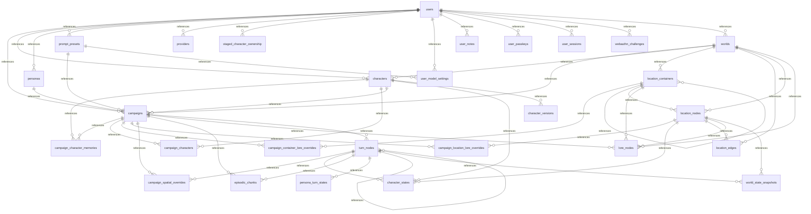

# Cross-Layer API, Schema & Package Index

## 1. FastAPI Routes <-> Frontend API Client Matrix

| Method | Path | Backend Handler | Response Schema | Frontend Client |
| :--- | :--- | :--- | :--- | :--- |
| `POST` | `/api/admin/embeddings/reindex` | `app.routers.settings.reindex_embeddings` | `dict` | `frontend/src/api/settings.ts` |
| `GET` | `/api/admin/embeddings/status` | `app.routers.settings.embedding_status` | `dict` | `frontend/src/api/settings.ts` |
| `GET` | `/api/admin/users` | `app.routers.auth.admin_list_users` | `list` | `frontend/src/api/auth.ts` |
| `POST` | `/api/admin/users` | `app.routers.auth.admin_create_user` | `UserProfile` | `frontend/src/api/auth.ts` |
| `DELETE` | `/api/admin/users/{user_id}` | `app.routers.auth.admin_delete_user` | `dict` | `frontend/src/api/auth.ts` |
| `POST` | `/api/admin/users/{user_id}/reset-password` | `app.routers.auth.admin_reset_user_password` | `AdminResetPasswordResponse` | `frontend/src/api/auth.ts` |
| `PUT` | `/api/admin/users/{user_id}/username` | `app.routers.auth.admin_change_username` | `UserProfile` | `frontend/src/api/auth.ts` |
| `POST` | `/api/auth/login` | `app.routers.auth.login_with_password` | `AuthSessionResponse` | `frontend/src/api/auth.ts` |
| `POST` | `/api/auth/logout` | `app.routers.auth.logout_user` | `dict` | `frontend/src/api/auth.ts` |
| `POST` | `/api/auth/passkey/login/finish` | `app.routers.auth.finish_passkey_login` | `AuthSessionResponse` | `frontend/src/api/auth.ts` |
| `POST` | `/api/auth/passkey/login/start` | `app.routers.auth.start_passkey_login` | `PasskeyLoginStartResponse` | `frontend/src/api/auth.ts` |
| `POST` | `/api/auth/register` | `app.routers.auth.register_user` | `AuthSessionResponse` | `frontend/src/api/auth.ts` |
| `POST` | `/api/auth/setup` | `app.routers.auth.initial_setup` | `AuthSessionResponse` | `frontend/src/api/auth.ts` |
| `GET` | `/api/auth/status` | `app.routers.auth.get_auth_status` | `AuthStatusResponse` | `frontend/src/api/auth.ts` |
| `GET` | `/api/campaigns` | `app.routers.campaign_routes.crud_and_state.list_campaigns` | `list` | `frontend/src/api/campaigns.ts` |
| `POST` | `/api/campaigns` | `app.routers.campaign_routes.crud_and_state.create_campaign` | `CampaignStateBundle` | `frontend/src/api/campaigns.ts` |
| `DELETE` | `/api/campaigns/{campaign_id}` | `app.routers.campaign_routes.crud_and_state.delete_campaign` | `dict` | `frontend/src/api/campaigns.ts` |
| `POST` | `/api/campaigns/{campaign_id}/characters` | `app.routers.campaign_routes.crud_and_state.add_campaign_character` | `CampaignStateBundle` | *(backend-only / test / SSE)* |
| `POST` | `/api/campaigns/{campaign_id}/characters/{character_id}/memories` | `app.routers.campaign_routes.crud_and_state.update_campaign_character_memories` | `CampaignStateBundle` | `frontend/src/api/campaigns.ts` |
| `POST` | `/api/campaigns/{campaign_id}/checkout` | `app.routers.campaign_routes.crud_and_state.checkout_campaign_branch` | `CampaignStateBundle` | `frontend/src/api/campaigns.ts` |
| `PUT` | `/api/campaigns/{campaign_id}/containers/{container_id}/lore` | `app.routers.campaign_routes.spatial_routes.update_campaign_container_lore` | `CampaignStateBundle` | `frontend/src/api/campaigns.ts` |
| `POST` | `/api/campaigns/{campaign_id}/edges` | `app.routers.campaign_routes.spatial_routes.connect_campaign_locations` | `CampaignStateBundle` | `frontend/src/api/campaigns.ts` |
| `DELETE` | `/api/campaigns/{campaign_id}/edges/{edge_id}` | `app.routers.campaign_routes.spatial_routes.remove_campaign_edge` | `CampaignStateBundle` | `frontend/src/api/campaigns.ts` |
| `PATCH` | `/api/campaigns/{campaign_id}/edges/{edge_id}` | `app.routers.campaign_routes.spatial_routes.update_campaign_edge_distance` | `CampaignStateBundle` | `frontend/src/api/campaigns.ts` |
| `POST` | `/api/campaigns/{campaign_id}/item-equip` | `app.routers.campaign_routes.crud_and_state.toggle_campaign_item_equip` | `CampaignStateBundle` | `frontend/src/api/campaigns.ts` |
| `POST` | `/api/campaigns/{campaign_id}/location-override` | `app.routers.campaign_routes.crud_and_state.override_campaign_location` | `CampaignStateBundle` | `frontend/src/api/campaigns.ts` |
| `POST` | `/api/campaigns/{campaign_id}/locations` | `app.routers.campaign_routes.spatial_routes.create_campaign_linked_location` | `CampaignStateBundle` | `frontend/src/api/campaigns.ts` |
| `PUT` | `/api/campaigns/{campaign_id}/locations/{location_id}/lore` | `app.routers.campaign_routes.spatial_routes.update_campaign_location_lore` | `CampaignStateBundle` | `frontend/src/api/campaigns.ts` |
| `PUT` | `/api/campaigns/{campaign_id}/map` | `app.routers.campaign_routes.spatial_routes.update_campaign_map` | `CampaignStateBundle` | `frontend/src/api/worlds.ts` |
| `GET` | `/api/campaigns/{campaign_id}/persona-state` | `app.routers.campaign_routes.crud_and_state.get_campaign_player_turn_state` | `Union` | `frontend/src/api/campaigns.ts` |
| `PUT` | `/api/campaigns/{campaign_id}/prompt-preset` | `app.routers.prompts.set_campaign_prompt_preset` | `CampaignRecord` | `frontend/src/api/prompts.ts` |
| `GET` | `/api/campaigns/{campaign_id}/state` | `app.routers.campaign_routes.crud_and_state.get_campaign_state` | `CampaignStateBundle` | `frontend/src/api/campaigns.ts` |
| `POST` | `/api/campaigns/{campaign_id}/turns` | `app.routers.campaign_routes.turn_streaming.submit_campaign_turn_sync` | `CampaignStateBundle` | *(backend-only / test / SSE)* |
| `DELETE` | `/api/campaigns/{campaign_id}/turns/last` | `app.routers.campaign_routes.crud_and_state.delete_campaign_last_turn` | `CampaignStateBundle` | `frontend/src/api/campaigns.ts` |
| `POST` | `/api/campaigns/{campaign_id}/turns/stream` | `app.routers.campaign_routes.turn_streaming.stream_campaign_turn` | — | `frontend/src/api/stream.ts` |
| `DELETE` | `/api/campaigns/{campaign_id}/turns/{turn_id}` | `app.routers.campaign_routes.crud_and_state.delete_campaign_turn` | `CampaignStateBundle` | *(backend-only / test / SSE)* |
| `GET` | `/api/characters` | `app.routers.characters.list_characters` | `list` | `frontend/src/api/characters.ts` |
| `DELETE` | `/api/characters/{character_id}` | `app.routers.characters.delete_character` | `dict` | `frontend/src/api/characters.ts` |
| `GET` | `/api/characters/{character_id}` | `app.routers.characters.get_character` | `CharacterRecord` | `frontend/src/api/characters.ts` |
| `PUT` | `/api/characters/{character_id}` | `app.routers.characters.update_character` | `CharacterRecord` | `frontend/src/api/characters.ts` |
| `POST` | `/api/characters/{character_id}/gallery` | `app.routers.characters.upload_character_gallery_image` | `CharacterRecord` | `frontend/src/api/characters.ts` |
| `DELETE` | `/api/characters/{character_id}/gallery/{image_id}` | `app.routers.characters.delete_character_gallery_image` | `CharacterRecord` | `frontend/src/api/characters.ts` |
| `DELETE` | `/api/characters/{character_id}/portraits/{emotion}` | `app.routers.characters.delete_character_portrait` | `CharacterRecord` | `frontend/src/api/characters.ts` |
| `POST` | `/api/characters/{character_id}/portraits/{emotion}` | `app.routers.characters.upload_character_portrait` | `CharacterRecord` | `frontend/src/api/characters.ts` |
| `GET` | `/api/characters/{character_id}/versions` | `app.routers.characters.list_character_versions` | `list` | `frontend/src/api/characters.ts` |
| `GET` | `/api/characters/{character_id}/versions/{version}` | `app.routers.characters.get_character_version` | `CharacterRecord` | `frontend/src/api/characters.ts` |
| `POST` | `/api/characters/{character_id}/versions/{version}/restore` | `app.routers.characters.restore_character_version` | `CharacterRecord` | `frontend/src/api/characters.ts` |
| `POST` | `/api/enrich` | `app.routers.enrich.enrich_text` | `PromptEnrichResponse` | `frontend/src/api/settings.ts` |
| `POST` | `/api/export/bundle` | `app.routers.import_export.export_bundle` | — | `frontend/src/api/importExport.ts` |
| `GET` | `/api/export/character/{character_id}` | `app.routers.import_export.export_single_character` | — | `frontend/src/api/importExport.ts` |
| `GET` | `/api/export/world/{world_id}` | `app.routers.import_export.export_single_world` | — | `frontend/src/api/importExport.ts` |
| `GET` | `/api/health` | `app.routers.settings.health_check` | `dict` | *(backend-only / test / SSE)* |
| `POST` | `/api/import/commit` | `app.routers.import_export.commit_import` | `ImportCommitResponse` | `frontend/src/api/importExport.ts` |
| `POST` | `/api/import/inspect` | `app.routers.import_export.inspect_import` | `ImportInspectResponse` | `frontend/src/api/importExport.ts` |
| `GET` | `/api/local-relay/status` | `app.routers.local_relay.get_local_relay_status` | `dict` | `frontend/src/api/providers.ts` |
| `WS` | `/api/local-relay/ws` | `app.routers.local_relay.local_relay_ws` | — | *(backend-only / test / SSE)* |
| `POST` | `/api/mechanics/choice-preview` | `app.routers.mechanics.preview_choices` | `ChoicePreviewResponse` | `frontend/src/api/campaigns.ts` |
| `GET` | `/api/media/characters/{character_id}/{category}/{filename}` | `app.routers.characters.get_character_media` | — | *(backend-only / test / SSE)* |
| `GET` | `/api/notes` | `app.routers.notes.list_my_notes` | `list` | `frontend/src/api/notes.ts` |
| `POST` | `/api/notes` | `app.routers.notes.create_my_note` | `UserNoteRecord` | `frontend/src/api/notes.ts` |
| `DELETE` | `/api/notes/{note_id}` | `app.routers.notes.delete_my_note` | `dict` | `frontend/src/api/notes.ts` |
| `GET` | `/api/notes/{note_id}` | `app.routers.notes.get_my_note` | `UserNoteRecord` | `frontend/src/api/notes.ts` |
| `PUT` | `/api/notes/{note_id}` | `app.routers.notes.update_my_note` | `UserNoteRecord` | `frontend/src/api/notes.ts` |
| `GET` | `/api/ollama/status` | `app.routers.settings.get_ollama_status` | `OllamaStatusResponse` | *(backend-only / test / SSE)* |
| `GET` | `/api/personas` | `app.routers.personas.list_user_personas` | `list` | `frontend/src/api/personas.ts` |
| `POST` | `/api/personas` | `app.routers.personas.create_persona` | `PersonaRecord` | `frontend/src/api/personas.ts` |
| `DELETE` | `/api/personas/{persona_id}` | `app.routers.personas.delete_persona` | — | `frontend/src/api/personas.ts` |
| `GET` | `/api/personas/{persona_id}` | `app.routers.personas.get_persona` | `PersonaRecord` | `frontend/src/api/personas.ts` |
| `PUT` | `/api/personas/{persona_id}` | `app.routers.personas.update_persona` | `PersonaRecord` | `frontend/src/api/personas.ts` |
| `DELETE` | `/api/profile` | `app.routers.auth.delete_my_account` | `dict` | `frontend/src/api/auth.ts` |
| `GET` | `/api/profile` | `app.routers.auth.get_my_profile` | `UserProfile` | `frontend/src/api/auth.ts` |
| `PUT` | `/api/profile` | `app.routers.auth.update_my_profile` | `UserProfile` | `frontend/src/api/auth.ts` |
| `POST` | `/api/profile/delete` | `app.routers.auth.delete_my_account` | `dict` | *(backend-only / test / SSE)* |
| `DELETE` | `/api/profile/models` | `app.routers.settings.reset_profile_models` | `ProfileModelSettingsResponse` | `frontend/src/api/settings.ts` |
| `GET` | `/api/profile/models` | `app.routers.settings.get_profile_models` | `ProfileModelSettingsResponse` | `frontend/src/api/settings.ts` |
| `PUT` | `/api/profile/models` | `app.routers.settings.update_profile_models` | `ProfileModelSettingsResponse` | `frontend/src/api/settings.ts` |
| `POST` | `/api/profile/passkeys/register/finish` | `app.routers.auth.finish_passkey_registration` | `UserProfile` | `frontend/src/api/auth.ts` |
| `POST` | `/api/profile/passkeys/register/start` | `app.routers.auth.start_passkey_registration` | `PasskeyRegisterStartResponse` | `frontend/src/api/auth.ts` |
| `POST` | `/api/profile/passkeys/{credential_id}/delete` | `app.routers.auth.delete_my_passkey` | `UserProfile` | `frontend/src/api/auth.ts` |
| `POST` | `/api/profile/password` | `app.routers.auth.change_my_password` | `AuthStatusResponse` | `frontend/src/api/auth.ts` |
| `POST` | `/api/profile/reset-data` | `app.routers.auth.reset_my_data` | `dict` | `frontend/src/api/auth.ts` |
| `GET` | `/api/prompts/active` | `app.routers.prompts.get_active_prompt_preset` | `dict` | `frontend/src/api/prompts.ts` |
| `PUT` | `/api/prompts/active` | `app.routers.prompts.set_active_prompt_preset` | `dict` | `frontend/src/api/prompts.ts` |
| `GET` | `/api/prompts/defaults` | `app.routers.prompts.get_prompt_defaults` | `PromptDefaultsResponse` | `frontend/src/api/prompts.ts` |
| `GET` | `/api/prompts/presets` | `app.routers.prompts.list_prompt_presets` | `list` | `frontend/src/api/prompts.ts` |
| `POST` | `/api/prompts/presets` | `app.routers.prompts.create_prompt_preset` | `PromptPresetRecord` | `frontend/src/api/prompts.ts` |
| `DELETE` | `/api/prompts/presets/{preset_id}` | `app.routers.prompts.delete_prompt_preset` | `dict` | `frontend/src/api/prompts.ts` |
| `GET` | `/api/prompts/presets/{preset_id}` | `app.routers.prompts.get_prompt_preset` | `PromptPresetRecord` | `frontend/src/api/prompts.ts` |
| `PUT` | `/api/prompts/presets/{preset_id}` | `app.routers.prompts.update_prompt_preset` | `PromptPresetRecord` | `frontend/src/api/prompts.ts` |
| `POST` | `/api/prompts/presets/{preset_id}/reset` | `app.routers.prompts.reset_prompt_preset` | `PromptPresetRecord` | `frontend/src/api/prompts.ts` |
| `GET` | `/api/providers` | `app.routers.providers.list_providers` | `list` | `frontend/src/api/providers.ts` |
| `POST` | `/api/providers` | `app.routers.providers.create_provider` | `ProviderResponse` | `frontend/src/api/providers.ts` |
| `POST` | `/api/providers/probe-draft` | `app.routers.providers.probe_draft` | `ProviderProbeResponse` | `frontend/src/api/providers.ts` |
| `DELETE` | `/api/providers/{provider_id}` | `app.routers.providers.delete_provider` | — | `frontend/src/api/providers.ts` |
| `PUT` | `/api/providers/{provider_id}` | `app.routers.providers.update_provider` | `ProviderResponse` | `frontend/src/api/providers.ts` |
| `POST` | `/api/providers/{provider_id}/client-probe` | `app.routers.providers.report_client_probe` | `ProviderProbeResponse` | `frontend/src/api/providers.ts` |
| `POST` | `/api/providers/{provider_id}/probe` | `app.routers.providers.probe_provider` | `ProviderProbeResponse` | *(backend-only / test / SSE)* |
| `GET` | `/api/settings` | `app.routers.settings.get_settings` | `AppSettings` | `frontend/src/api/settings.ts` |
| `PUT` | `/api/settings` | `app.routers.settings.update_settings` | `SettingsUpdateResponse` | `frontend/src/api/settings.ts` |
| `POST` | `/api/wizards/character/commit` | `app.routers.characters.wizard_commit_character` | `CharacterRecord` | `frontend/src/api/characters.ts` |
| `POST` | `/api/wizards/character/draft` | `app.routers.characters.wizard_draft_character` | `CharacterWizardDraft` | `frontend/src/api/characters.ts` |
| `POST` | `/api/wizards/character/extract-features` | `app.routers.characters.extract_character_features` | `CharacterFeatureExtractionResponse` | `frontend/src/api/characters.ts` |
| `POST` | `/api/wizards/character/extract-persona-traits` | `app.routers.characters.extract_character_persona_traits` | `CharacterPersonaExtractionResponse` | `frontend/src/api/characters.ts` |
| `POST` | `/api/wizards/character/extract-quirks` | `app.routers.characters.extract_character_quirks` | `CharacterQuirksExtractionResponse` | `frontend/src/api/characters.ts` |
| `POST` | `/api/wizards/character/import-sillytavern` | `app.routers.characters.wizard_import_sillytavern_card` | `SillyTavernImportResponse` | `frontend/src/api/characters.ts` |
| `POST` | `/api/wizards/world/commit` | `app.routers.worlds.wizard_commit_world` | `WorldRecord` | `frontend/src/api/worlds.ts` |
| `POST` | `/api/wizards/world/draft` | `app.routers.worlds.wizard_draft_world` | `WorldWizardDraft` | `frontend/src/api/worlds.ts` |
| `POST` | `/api/wizards/world/reimagine-map` | `app.routers.worlds.wizard_reimagine_map` | `WorldMapDraft` | `frontend/src/api/worlds.ts` |
| `GET` | `/api/worlds` | `app.routers.worlds.list_worlds` | `list` | `frontend/src/api/worlds.ts` |
| `DELETE` | `/api/worlds/{world_id}` | `app.routers.worlds.delete_world` | `dict` | `frontend/src/api/worlds.ts` |
| `GET` | `/api/worlds/{world_id}` | `app.routers.worlds.get_world` | `WorldRecord` | `frontend/src/api/worlds.ts` |
| `PUT` | `/api/worlds/{world_id}` | `app.routers.worlds.update_world` | `WorldRecord` | `frontend/src/api/worlds.ts` |
| `DELETE` | `/api/worlds/{world_id}/containers/{container_id}` | `app.routers.worlds.delete_world_container` | `WorldRecord` | *(backend-only / test / SSE)* |
| `POST` | `/api/worlds/{world_id}/locations/{location_id}/convert-to-container` | `app.routers.worlds.convert_location_to_container` | `WorldRecord` | `frontend/src/api/worlds.ts` |

## 2. SQLite Schema (`backend/app/db/schema.sql`)

| Table | DDL Line | Foreign-Key Parents |
| :--- | ---: | :--- |
| `users` | 6 | — |
| `user_passkeys` | 18 | `users` |
| `user_sessions` | 32 | `users` |
| `prompt_presets` | 45 | `users` |
| `user_model_settings` | 58 | `prompt_presets`, `users` |
| `worlds` | 78 | `users` |
| `location_containers` | 87 | `location_containers`, `worlds` |
| `location_nodes` | 105 | `location_containers`, `worlds` |
| `location_edges` | 127 | `location_nodes`, `worlds` |
| `characters` | 142 | `users`, `worlds` |
| `character_versions` | 181 | `characters` |
| `personas` | 192 | `users` |
| `campaigns` | 215 | `characters`, `personas`, `prompt_presets`, `users`, `worlds` |
| `campaign_characters` | 228 | `campaigns`, `characters` |
| `campaign_character_memories` | 238 | `campaigns`, `characters` |
| `lore_nodes` | 248 | `campaigns`, `location_containers`, `location_nodes`, `worlds` |
| `campaign_location_lore_overrides` | 277 | `campaigns`, `location_nodes` |
| `campaign_container_lore_overrides` | 284 | `campaigns`, `location_containers` |
| `turn_nodes` | 291 | `campaigns`, `turn_nodes` |
| `world_state_snapshots` | 311 | `location_nodes`, `turn_nodes` |
| `campaign_spatial_overrides` | 320 | `campaigns`, `turn_nodes` |
| `character_states` | 336 | `characters`, `location_nodes`, `turn_nodes` |
| `persona_turn_states` | 354 | `turn_nodes` |
| `episodic_chunks` | 360 | `campaigns`, `turn_nodes` |
| `vector_entries` | 377 | — |
| `user_notes` | 398 | `users` |
| `staged_character_ownership` | 413 | `users` |
| `webauthn_challenges` | 420 | `users` |
| `app_meta` | 435 | — |
| `providers` | 441 | `users` |

## 3. Domain Package File Index

### Backend (`backend/app/`)

#### `app`

| File | LOC | Summary |
| :--- | ---: | :--- |
| `backend/app/__init__.py` | 1 | CyberCantina Backend Application. |

#### `app.auth`

| File | LOC | Summary |
| :--- | ---: | :--- |
| `backend/app/auth.py` | 358 | Authentication, Password Hashing (Argon2id), WebAuthn Passkeys, and 24h Sliding Sessions. |

#### `app.config`

| File | LOC | Summary |
| :--- | ---: | :--- |
| `backend/app/config.py` | 312 | Configuration management for CyberCantina LLM roles and memory settings. |

#### `app.db`

| File | LOC | Summary |
| :--- | ---: | :--- |
| `backend/app/db/__init__.py` | 1 | Database, graph repository, and vector store layer. |
| `backend/app/db/provider_store.py` | 350 | SQLite persistence for LLM providers (tenant-scoped, optimistic concurrency, sealed secrets). |
| `backend/app/db/repository.py` | 56 | Branch-aware SQLite repository for Worlds, Characters, Spatial Graph, and Turn Trees. |
| `backend/app/db/seed.py` | 339 | Default showcase scenario seeder ('Midnight at the Neon Rust'). |
| `backend/app/db/vector_math.py` | 365 | Embedding helpers, lexical TF-IDF activations, MMR, and RRF math. |
| `backend/app/db/vector_store.py` | 764 | Hybrid semantic vector store and branch-aware memory retrieval. |

#### `app.db.repos`

| File | LOC | Summary |
| :--- | ---: | :--- |
| `backend/app/db/repos/__init__.py` | 34 | Domain repository mixins composed into CantinaRepository. |
| `backend/app/db/repos/auth_users.py` | 845 | Users, passkeys, sessions, and per-user model settings persistence. |
| `backend/app/db/repos/base.py` | 310 | Core SQLite connection, media helpers, and vector/provider bindings. |
| `backend/app/db/repos/campaign_lore_items.py` | 741 | Campaign item equip toggles and location/container lore overrides. |
| `backend/app/db/repos/campaign_map_update.py` | 574 | Campaign full map bulk update and spatial synchronization. |
| `backend/app/db/repos/campaign_spatial.py` | 572 | Campaign location overrides, edges, spatial projections, and row mappers. |
| `backend/app/db/repos/campaigns.py` | 477 | Campaign creation, membership, and prompt preset assignment. |
| `backend/app/db/repos/character_versions.py` | 865 | Character updates, version history snapshots/restores, and campaign memory edits. |
| `backend/app/db/repos/characters.py` | 557 | Character creation, access checks, media staging, portraits/gallery, and soft-deletion. |
| `backend/app/db/repos/notes.py` | 298 | User notes persistence and row mapping. |
| `backend/app/db/repos/personas.py` | 394 | Player personas and dynamic campaign persona turn state. |
| `backend/app/db/repos/prompt_presets.py` | 284 | Prompt preset CRUD and effective prompt resolution. |
| `backend/app/db/repos/schema_init.py` | 1108 | SQLite DDL initialization and legacy schema migrations. |
| `backend/app/db/repos/turns.py` | 1134 | Turn tree persistence, episodic chunks, branch checkout, and state bundles. |
| `backend/app/db/repos/world_locations.py` | 674 | Location containers, neighbors, and improvised location creation. |
| `backend/app/db/repos/worlds.py` | 1176 | World CRUD, scoped lore helpers, and pending-deletion pruning. |

#### `app.dependencies`

| File | LOC | Summary |
| :--- | ---: | :--- |
| `backend/app/dependencies.py` | 361 | Shared dependency injection, configuration resolution, and media utilities. |

#### `app.engine`

| File | LOC | Summary |
| :--- | ---: | :--- |
| `backend/app/engine/__init__.py` | 1 | 4-Phase Agentic Turn Execution Engine. |

#### `app.engine.affective`

| File | LOC | Summary |
| :--- | ---: | :--- |
| `backend/app/engine/affective/__init__.py` | 178 | CARE-v1 affective mathematics, lexical rendering, and post-turn appraisal package. |
| `backend/app/engine/affective/dynamics.py` | 492 | Continuous decay, Kalman mood updates, composure masking, and Gottman steps. |
| `backend/app/engine/affective/hydration.py` | 275 | Legacy snapshot hydration, seeding, and CARE state materialization. |
| `backend/app/engine/affective/lexical.py` | 630 | Lexical rendering (zero-raw-float PAD/CARE/edge descriptions for Zone 4). |
| `backend/app/engine/affective/models.py` | 274 | Mathematical constants, dataclasses, and low-level CARE helpers. |
| `backend/app/engine/affective/post_turn.py` | 853 | Post-turn CARE appraisal, salience clamping, and witness coupling. |

#### `app.engine.affective_engine`

| File | LOC | Summary |
| :--- | ---: | :--- |
| `backend/app/engine/affective_engine.py` | 211 | CARE-v1 Affective Mathematics, Lexical Rendering, Hydration & Post-Turn Appraisal Engine. |

#### `app.engine.char_agent`

| File | LOC | Summary |
| :--- | ---: | :--- |
| `backend/app/engine/char_agent/__init__.py` | 79 | Character Post-Turn State & Inventory Arbitration package. |
| `backend/app/engine/char_agent/agent.py` | 732 | Heuristic delta extraction and LLM character post-turn state agent. |
| `backend/app/engine/char_agent/inventory.py` | 743 | Permanent item locking, character inventory deltas, and contest arbitration. |
| `backend/app/engine/char_agent/matching.py` | 375 | Item token matching, mood normalization, and relationship stance formatting. |

#### `app.engine.character_agent`

| File | LOC | Summary |
| :--- | ---: | :--- |
| `backend/app/engine/character_agent.py` | 79 | Character State Agent & Inventory Arbitration. |

#### `app.engine.choices`

| File | LOC | Summary |
| :--- | ---: | :--- |
| `backend/app/engine/choices.py` | 541 | Pure engine logic, deterministic condition gating, and compliance for Director Choices. |

#### `app.engine.clerk`

| File | LOC | Summary |
| :--- | ---: | :--- |
| `backend/app/engine/clerk/__init__.py` | 88 | Phase 5 async post-turn clerk & character state package. |
| `backend/app/engine/clerk/episodic.py` | 308 | Episodic chunk witnesses, salience scoring, and structured LLM chunk summarization. |
| `backend/app/engine/clerk/gossip.py` | 190 | Scene-flag merging, prose-verified persona gossip exchange, and persona unlock tracking. |
| `backend/app/engine/clerk/heuristics.py` | 231 | Offline heuristic post-turn world and spatial/inventory delta extraction. |
| `backend/app/engine/clerk/inventory.py` | 190 | Inventory item normalization, removal matching, merging, and heuristic item deltas. |
| `backend/app/engine/clerk/memories.py` | 458 | Heuristic character memory extraction, deduplication, resolution, and compaction. |
| `backend/app/engine/clerk/pipeline.py` | 1028 | Phase 5 async post-turn clerk orchestrator and passive bystander fast-pathing. |

#### `app.engine.clerk_placement`

| File | LOC | Summary |
| :--- | ---: | :--- |
| `backend/app/engine/clerk_placement.py` | 103 | Clerk Scene Staging Engine for World-focused Campaign Starts. |

#### `app.engine.cognition`

| File | LOC | Summary |
| :--- | ---: | :--- |
| `backend/app/engine/cognition/__init__.py` | 64 | Phase 3 Character Cognition & Hidden Thought Generation package. |
| `backend/app/engine/cognition/heuristics.py` | 280 | Offline heuristic cognition fallback and episodic memory recall selection. |
| `backend/app/engine/cognition/runner.py` | 752 | Phase 3 character cognition LLM execution and multi-actor orchestration. |
| `backend/app/engine/cognition/xml_parser.py` | 339 | Cognition XML parsing, feeling attribute extraction, and text sanitization. |

#### `app.engine.context`

| File | LOC | Summary |
| :--- | ---: | :--- |
| `backend/app/engine/context/__init__.py` | 108 | Phase 2 context scoping, Zone 1-4 prompt building, and turn bundle assembly. |
| `backend/app/engine/context/assembler.py` | 504 | Phase 2 turn context resolver and 4-zone prompt message assembler. |
| `backend/app/engine/context/lore_scope.py` | 733 | Token budget estimation, actor context ceilings, working windows, container chains, and lore scoping. |
| `backend/app/engine/context/zone1_static.py` | 316 | Zone 1 KV-cached static system prompt assembly and discovered-persona views. |
| `backend/app/engine/context/zone2_episodic.py` | 390 | Zone 2 LOD episodic memory rendering, vector recall packing, and compacted turn elevation. |
| `backend/app/engine/context/zone4_ephemeral.py` | 606 | Zone 4 ephemeral tail frame and elapsed snapshot state projection. |

#### `app.engine.llm_client`

| File | LOC | Summary |
| :--- | ---: | :--- |
| `backend/app/engine/llm_client.py` | 819 | Ollama-first & OpenAI-compatible LLM client with model discovery and grammar-constrained JSON. |

#### `app.engine.mentions`

| File | LOC | Summary |
| :--- | ---: | :--- |
| `backend/app/engine/mentions.py` | 265 | Targeted Character Mentions and Mixed Sensory Whisper Engine. |

#### `app.engine.phase1_pre`

| File | LOC | Summary |
| :--- | ---: | :--- |
| `backend/app/engine/phase1_pre.py` | 1020 | Phase 1: Auxiliary Pre-Turn Analyzer & Native RNG/Dice Mechanics Resolver. |

#### `app.engine.phase2_context`

| File | LOC | Summary |
| :--- | ---: | :--- |
| `backend/app/engine/phase2_context.py` | 155 | Phase 2: Context Builder, 4-Zone KV-Cache Prompt Assembly & Long-Term Memory Injection. |

#### `app.engine.phase3_actor`

| File | LOC | Summary |
| :--- | ---: | :--- |
| `backend/app/engine/phase3_actor.py` | 69 | Backward-compatibility shim for Phase 3 Actor & Cognition. |

#### `app.engine.phase3_cognition`

| File | LOC | Summary |
| :--- | ---: | :--- |
| `backend/app/engine/phase3_cognition.py` | 92 | Phase 3: Character Cognition & Hidden Thought Generation. |

#### `app.engine.phase4_clerk`

| File | LOC | Summary |
| :--- | ---: | :--- |
| `backend/app/engine/phase4_clerk.py` | 12 | Backward-compatibility shim for Phase 4 Clerk. |

#### `app.engine.phase4_prose`

| File | LOC | Summary |
| :--- | ---: | :--- |
| `backend/app/engine/phase4_prose.py` | 418 | Phase 4: Narrative Prose Generation & Streaming. |

#### `app.engine.phase5_clerk`

| File | LOC | Summary |
| :--- | ---: | :--- |
| `backend/app/engine/phase5_clerk.py` | 139 | Phase 5: Async Post-Turn Clerk & Character State Engine. |

#### `app.engine.world_clock`

| File | LOC | Summary |
| :--- | ---: | :--- |
| `backend/app/engine/world_clock.py` | 237 | In-world clock helpers: parsing, describing, advancing, and extracting narrative time hints. |

#### `app.main`

| File | LOC | Summary |
| :--- | ---: | :--- |
| `backend/app/main.py` | 191 | FastAPI entrypoint and application orchestrator for CyberCantina. |

#### `app.prompts`

| File | LOC | Summary |
| :--- | ---: | :--- |
| `backend/app/prompts/__init__.py` | 43 | Prompt presets and templating package for CyberCantina. |
| `backend/app/prompts/defaults.py` | 870 | Factory default prompt templates, preset definitions, and metadata for CyberCantina. |
| `backend/app/prompts/renderer.py` | 56 | Template rendering and validation engine for prompts. |

#### `app.providers`

| File | LOC | Summary |
| :--- | ---: | :--- |
| `backend/app/providers/__init__.py` | 1 | Provider fleet: persistence-independent building blocks (endpoint, resolver, probe, seeder). |
| `backend/app/providers/endpoint.py` | 24 | Leaf module (no app imports) holding the resolved-endpoint value object. |
| `backend/app/providers/local_relay.py` | 435 | In-memory WebSocket relay hub bridging backend LLM calls to browser-local drivers. |
| `backend/app/providers/models.py` | 84 | Model catalog parsing shared by probes and the legacy Ollama status call. |
| `backend/app/providers/openrouter_catalog.py` | 197 | Global singleton in-memory cache for OpenRouter model catalog. |
| `backend/app/providers/probe.py` | 320 | Provider health probing: bounded, single-flight, cached, SSRF-checked, secret-safe. |
| `backend/app/providers/references.py` | 62 | Find (and clear) everything that points at a provider: system roles and per-user overrides. |
| `backend/app/providers/resolver.py` | 91 | Resolve a role profile's ``provider_id`` to a callable endpoint, enforcing visibility at call time. |
| `backend/app/providers/seeder.py` | 347 | One-way migration: derive providers from the pre-existing actor/clerk/embedding settings. |
| `backend/app/providers/settings_service.py` | 80 | Applying admin settings: reference validation, BYOP coupling, revision check, atomic persist. |
| `backend/app/providers/webgpu_catalog.py` | 132 | Curated WebGPU (WebLLM) model catalog and context ceilings. |

#### `app.routers`

| File | LOC | Summary |
| :--- | ---: | :--- |
| `backend/app/routers/__init__.py` | 1 | FastAPI APIRouter modules for CyberCantina. |
| `backend/app/routers/auth.py` | 595 | Authentication, passkeys, user profiles, and admin user management router. |
| `backend/app/routers/campaigns.py` | 120 | Campaign Management, Turn Streaming & Spatial State API Router. |
| `backend/app/routers/characters.py` | 583 | Characters, versioning, SillyTavern importer, and character media router. |
| `backend/app/routers/enrich.py` | 345 | Router for the AI Magic Wand text enrichment service. |
| `backend/app/routers/import_export.py` | 167 | FastAPI router for native CyberCantina archive (.zcc) export, auto-detect inspect, and commit. |
| `backend/app/routers/local_relay.py` | 129 | WebSocket endpoint and status API for the browser-local inference relay. |
| `backend/app/routers/mechanics.py` | 21 | Mechanics and dice preview API router. |
| `backend/app/routers/notes.py` | 91 | Private user notes router. |
| `backend/app/routers/personas.py` | 118 | User personas REST router. |
| `backend/app/routers/prompts.py` | 234 | Prompt presets and template customization router. |
| `backend/app/routers/providers.py` | 406 | Provider fleet API: tenant-scoped CRUD, probing, and policy enforcement. |
| `backend/app/routers/settings.py` | 319 | Health, Ollama status, runtime settings, and user model overrides router. |
| `backend/app/routers/worlds.py` | 182 | Worlds and world creation wizard router. |

#### `app.routers.campaign_routes`

| File | LOC | Summary |
| :--- | ---: | :--- |
| `backend/app/routers/campaign_routes/__init__.py` | 106 | Campaign REST & SSE endpoints package. |
| `backend/app/routers/campaign_routes/crud_and_state.py` | 329 | Campaign CRUD, branching, character membership, inventory equip, and turn deletion endpoints. |
| `backend/app/routers/campaign_routes/schemas_and_gate.py` | 105 | Campaign router instance, request schemas, concurrency turn gate, and monkeypatch resolver. |
| `backend/app/routers/campaign_routes/spatial_routes.py` | 186 | Campaign linked-location, edge distance, map layout, and lore endpoints. |
| `backend/app/routers/campaign_routes/turn_streaming.py` | 864 | Campaign turn execution pipeline, SSE streaming, and synchronous turn submission. |

#### `app.schemas`

| File | LOC | Summary |
| :--- | ---: | :--- |
| `backend/app/schemas/__init__.py` | 27 | Pydantic v2 data contracts for CyberCantina. |
| `backend/app/schemas/affective.py` | 722 | Core Pydantic schemas, enums, and archetype presets for the CARE psychology engine. |
| `backend/app/schemas/auth.py` | 207 | Pydantic schemas for Multi-User Authentication, WebAuthn Passkeys, Profile, and Admin. |
| `backend/app/schemas/character.py` | 1293 | Character, psyche, memory shard, and cognition schemas. |
| `backend/app/schemas/enrich.py` | 68 | Pydantic schemas for the AI Magic Wand text enrichment endpoint. |
| `backend/app/schemas/import_export.py` | 104 | Schemas for native CyberCantina archive (.zcc) export and import. |
| `backend/app/schemas/mechanics.py` | 63 | Schemas for mechanics checks, previews, and dice calculations. |
| `backend/app/schemas/note.py` | 32 | Schemas for User Notes. |
| `backend/app/schemas/persona.py` | 267 | User persona, knowledge visibility, and dynamic state schemas. |
| `backend/app/schemas/prompt.py` | 49 | Schemas for Prompt Presets, Template Customization, and Documentation. |
| `backend/app/schemas/provider.py` | 175 | Pydantic schemas and domain records for LLM providers. |
| `backend/app/schemas/turn.py` | 1118 | Turn pipeline, mechanics/RNG, state snapshot, and campaign tree schemas. |
| `backend/app/schemas/world.py` | 897 | World settings, spatial topology graph, and lore schemas. |

#### `app.security`

| File | LOC | Summary |
| :--- | ---: | :--- |
| `backend/app/security/__init__.py` | 1 | Security helpers: secret encryption at rest and outbound URL policy. |
| `backend/app/security/log_sanitize.py` | 8 | Log sanitation helpers preventing CR/LF log injection. |
| `backend/app/security/media_path.py` | 70 | Safe filesystem path validation and resolution helpers for character media assets. |
| `backend/app/security/secret_box.py` | 79 | Encryption at rest for provider credentials (Fernet, auto-generated key file). |
| `backend/app/security/url_policy.py` | 143 | Outbound URL normalization and SSRF policy for provider endpoints. |

#### `app.services`

| File | LOC | Summary |
| :--- | ---: | :--- |
| `backend/app/services/__init__.py` | 1 | Application-layer services orchestrating domain workflows (`import_export_service`). |
| `backend/app/services/import_export_service.py` | 931 | Service for packaging, inspecting, and ingesting CyberCantina archives (.zcc). |

#### `app.wizards`

| File | LOC | Summary |
| :--- | ---: | :--- |
| `backend/app/wizards/__init__.py` | 1 | AI-driven Character and World Graph Creation Wizards. |
| `backend/app/wizards/character_extractor.py` | 422 | Extraction and surgical prose rephrasing for character bio and core persona. |
| `backend/app/wizards/character_wizard.py` | 49 | AI Character Generation Wizard & Deterministic Fallbacks. |
| `backend/app/wizards/sillytavern_distiller.py` | 422 | Cognitive distillation and world synthesis for SillyTavern character cards. |
| `backend/app/wizards/sillytavern_parser.py` | 273 | Parser and normalizer for SillyTavern character cards (V1/V2 JSON and embedded PNGs). |
| `backend/app/wizards/world_wizard.py` | 431 | 1.2 World & Spatial Graph Wizard: Generates world rules, connected locations, and lore. |

#### `app.wizards.char_gen`

| File | LOC | Summary |
| :--- | ---: | :--- |
| `backend/app/wizards/char_gen/__init__.py` | 43 | AI Character Creation Wizard (3-Pass Pipeline & Multi-Genre Fallbacks). |
| `backend/app/wizards/char_gen/draft_pipeline.py` | 460 | 3-pass AI character draft generation pipeline. |
| `backend/app/wizards/char_gen/genre_profiles.py` | 456 | Multi-genre character fallback profiles and sanitization helpers. |
| `backend/app/wizards/char_gen/inference.py` | 560 | Deterministic demographic, moral/quirk, dialogue anchor, and offline fallback inference. |

### Frontend (`frontend/src/`)

#### `App`

| File | LOC |
| :--- | ---: |
| `frontend/src/App.tsx` | 842 |

#### `api`

| File | LOC |
| :--- | ---: |
| `frontend/src/api/auth.ts` | 296 |
| `frontend/src/api/campaigns.ts` | 185 |
| `frontend/src/api/characters.ts` | 190 |
| `frontend/src/api/client.ts` | 235 |
| `frontend/src/api/importExport.ts` | 55 |
| `frontend/src/api/index.ts` | 37 |
| `frontend/src/api/notes.ts` | 29 |
| `frontend/src/api/personas.ts` | 29 |
| `frontend/src/api/prompts.ts` | 59 |
| `frontend/src/api/providers.ts` | 63 |
| `frontend/src/api/settings.ts` | 56 |
| `frontend/src/api/stream.ts` | 205 |
| `frontend/src/api/worlds.ts` | 119 |

#### `components (root)`

| File | LOC |
| :--- | ---: |
| `frontend/src/components/AppModals.tsx` | 441 |
| `frontend/src/components/AppSidebar.tsx` | 605 |
| `frontend/src/components/AuthModals.tsx` | 10 |
| `frontend/src/components/CharacterMentionPicker.tsx` | 101 |
| `frontend/src/components/ChatStage.tsx` | 1133 |
| `frontend/src/components/CommaSeparatedInput.tsx` | 65 |
| `frontend/src/components/DeleteConfirmationModal.tsx` | 231 |
| `frontend/src/components/EntityEditorModals.tsx` | 15 |
| `frontend/src/components/ExportBundleModal.tsx` | 688 |
| `frontend/src/components/HomeEntityPickerModal.tsx` | 536 |
| `frontend/src/components/HomeScreen.tsx` | 692 |
| `frontend/src/components/ImportPreviewModal.tsx` | 543 |
| `frontend/src/components/LiveInspector.tsx` | 673 |
| `frontend/src/components/MagicWandButton.tsx` | 176 |
| `frontend/src/components/NewCampaignModal.tsx` | 854 |
| `frontend/src/components/NotesDrawer.tsx` | 898 |
| `frontend/src/components/PersonaEditorModal.tsx` | 1160 |
| `frontend/src/components/PromptPresetsManager.tsx` | 722 |
| `frontend/src/components/SettingsModal.tsx` | 458 |
| `frontend/src/components/SidebarCategory.tsx` | 187 |
| `frontend/src/components/SpatialTopologyView.tsx` | 950 |
| `frontend/src/components/TagChipsInput.tsx` | 218 |
| `frontend/src/components/WizardModals.tsx` | 770 |

#### `components/auth`

| File | LOC |
| :--- | ---: |
| `frontend/src/components/auth/AdminModal.tsx` | 328 |
| `frontend/src/components/auth/AdminModelsTab.tsx` | 435 |
| `frontend/src/components/auth/AdminUsersTab.tsx` | 822 |
| `frontend/src/components/auth/AuthScreen.tsx` | 246 |
| `frontend/src/components/auth/FeedbackModal.tsx` | 80 |
| `frontend/src/components/auth/InitialSetupScreen.tsx` | 231 |
| `frontend/src/components/auth/ProfileAccountTab.tsx` | 1005 |
| `frontend/src/components/auth/ProfileModal.tsx` | 304 |
| `frontend/src/components/auth/ProfilePreferencesTab.tsx` | 904 |

#### `components/character`

| File | LOC |
| :--- | ---: |
| `frontend/src/components/character/CharacterAppearanceTab.tsx` | 348 |
| `frontend/src/components/character/CharacterBaseTab.tsx` | 237 |
| `frontend/src/components/character/CharacterInspectorModal.tsx` | 892 |
| `frontend/src/components/character/CharacterInventoryTab.tsx` | 557 |
| `frontend/src/components/character/CharacterMediaTab.tsx` | 644 |
| `frontend/src/components/character/CharacterMemoriesTab.tsx` | 185 |
| `frontend/src/components/character/CharacterPersonalityTab.tsx` | 624 |
| `frontend/src/components/character/CharacterVoiceTab.tsx` | 206 |
| `frontend/src/components/character/characterMediaUtils.ts` | 52 |
| `frontend/src/components/character/index.ts` | 4 |

#### `components/chat`

| File | LOC |
| :--- | ---: |
| `frontend/src/components/chat/ChatComposer.tsx` | 756 |
| `frontend/src/components/chat/DirectorChoicesDrawer.tsx` | 442 |
| `frontend/src/components/chat/LiveStreamingTurnCard.tsx` | 371 |
| `frontend/src/components/chat/TurnCard.tsx` | 1083 |
| `frontend/src/components/chat/chatHelpers.tsx` | 153 |

#### `components/inspector`

| File | LOC |
| :--- | ---: |
| `frontend/src/components/inspector/AgentChangesModal.tsx` | 1035 |
| `frontend/src/components/inspector/CampaignCharacterModal.tsx` | 454 |
| `frontend/src/components/inspector/CharacterRow.tsx` | 488 |
| `frontend/src/components/inspector/InspectorInternalsSection.tsx` | 146 |
| `frontend/src/components/inspector/InspectorLocationCard.tsx` | 565 |
| `frontend/src/components/inspector/InspectorPrimitives.tsx` | 133 |
| `frontend/src/components/inspector/LoreIndexModal.tsx` | 389 |
| `frontend/src/components/inspector/campaignCharacter/CampaignCharacterInventoryTab.tsx` | 788 |
| `frontend/src/components/inspector/campaignCharacter/CampaignCharacterMediaTab.tsx` | 366 |
| `frontend/src/components/inspector/campaignCharacter/CampaignCharacterMemoriesTab.tsx` | 373 |
| `frontend/src/components/inspector/campaignCharacter/CampaignCharacterStateTab.tsx` | 624 |

#### `components/map`

| File | LOC |
| :--- | ---: |
| `frontend/src/components/map/MapDetailsDrawer.tsx` | 943 |
| `frontend/src/components/map/MapDialogs.tsx` | 1026 |
| `frontend/src/components/map/MapLoreSection.tsx` | 510 |
| `frontend/src/components/map/MapPaletteBar.tsx` | 234 |
| `frontend/src/components/map/PortalPromotionModal.tsx` | 220 |
| `frontend/src/components/map/SpatialTopologyCanvas.tsx` | 963 |
| `frontend/src/components/map/TopologyHeaderToolbar.tsx` | 262 |
| `frontend/src/components/map/mapIcons.ts` | 103 |
| `frontend/src/components/map/mapValidation.ts` | 379 |
| `frontend/src/components/map/topologyProjection.ts` | 725 |
| `frontend/src/components/map/useTopologyMutations.ts` | 1283 |
| `frontend/src/components/map/useTopologyPointerDrag.ts` | 405 |

#### `components/models`

| File | LOC |
| :--- | ---: |
| `frontend/src/components/models/DisclosureSection.tsx` | 53 |
| `frontend/src/components/models/IntegerField.tsx` | 87 |
| `frontend/src/components/models/ModelCard.tsx` | 609 |
| `frontend/src/components/models/ModelDeck.tsx` | 565 |
| `frontend/src/components/models/ModelPicker.tsx` | 294 |
| `frontend/src/components/models/ModelRoleEditor.tsx` | 154 |
| `frontend/src/components/models/NumericSliderField.tsx` | 156 |
| `frontend/src/components/models/ThemedPickerDropdown.tsx` | 225 |
| `frontend/src/components/models/modelFormatting.ts` | 80 |
| `frontend/src/components/models/modelLimits.ts` | 100 |
| `frontend/src/components/models/modelPickerLogic.ts` | 123 |
| `frontend/src/components/models/sliderMath.ts` | 83 |

#### `components/prompts`

| File | LOC |
| :--- | ---: |
| `frontend/src/components/prompts/PromptRoleCard.tsx` | 91 |
| `frontend/src/components/prompts/PromptRoleDeck.tsx` | 45 |
| `frontend/src/components/prompts/promptRoleDefinitions.ts` | 78 |

#### `components/providers`

| File | LOC |
| :--- | ---: |
| `frontend/src/components/providers/ProviderBadges.tsx` | 114 |
| `frontend/src/components/providers/ProviderCard.tsx` | 84 |
| `frontend/src/components/providers/ProviderEditor.tsx` | 647 |
| `frontend/src/components/providers/ProvidersContext.tsx` | 283 |
| `frontend/src/components/providers/ProvidersManager.tsx` | 122 |

#### `components/shared`

| File | LOC |
| :--- | ---: |
| `frontend/src/components/shared/ClickToEditField.tsx` | 146 |

#### `components/wizard`

| File | LOC |
| :--- | ---: |
| `frontend/src/components/wizard/WorldWizardModal.tsx` | 176 |
| `frontend/src/components/wizard/genreFallbacks.ts` | 489 |

#### `components/world`

| File | LOC |
| :--- | ---: |
| `frontend/src/components/world/WorldInspectorModal.tsx` | 1120 |
| `frontend/src/components/world/worldDraftMappers.ts` | 233 |

#### `hooks`

| File | LOC |
| :--- | ---: |
| `frontend/src/hooks/useCampaignTurnActions.ts` | 550 |
| `frontend/src/hooks/useMagicWand.ts` | 169 |

#### `local`

| File | LOC |
| :--- | ---: |
| `frontend/src/local/ollamaDriver.ts` | 311 |
| `frontend/src/local/types.ts` | 56 |
| `frontend/src/local/webgpu.worker.ts` | 7 |
| `frontend/src/local/webgpuCatalog.ts` | 182 |
| `frontend/src/local/webgpuDriver.ts` | 222 |

#### `main`

| File | LOC |
| :--- | ---: |
| `frontend/src/main.tsx` | 10 |

#### `providers`

| File | LOC |
| :--- | ---: |
| `frontend/src/providers/LocalRelayContext.tsx` | 447 |

#### `types`

| File | LOC |
| :--- | ---: |
| `frontend/src/types/affective.ts` | 202 |
| `frontend/src/types/auth.ts` | 112 |
| `frontend/src/types/character.ts` | 283 |
| `frontend/src/types/importExport.ts` | 69 |
| `frontend/src/types/index.ts` | 11 |
| `frontend/src/types/mechanics.ts` | 128 |
| `frontend/src/types/notes.ts` | 26 |
| `frontend/src/types/persona.ts` | 90 |
| `frontend/src/types/prompts.ts` | 43 |
| `frontend/src/types/providers.ts` | 203 |
| `frontend/src/types/turn.ts` | 446 |
| `frontend/src/types/world.ts` | 177 |

#### `utils`

| File | LOC |
| :--- | ---: |
| `frontend/src/utils/choiceCommand.ts` | 162 |
| `frontend/src/utils/entityImages.ts` | 89 |
| `frontend/src/utils/importExportLogic.ts` | 233 |
| `frontend/src/utils/mentions.ts` | 113 |
| `frontend/src/utils/narratorCognition.ts` | 64 |
| `frontend/src/utils/noteSearch.ts` | 109 |
