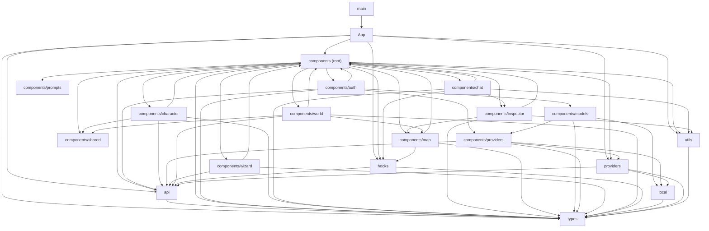

# Frontend Module & Boundary Graph

Rules enforced by `npm --prefix frontend run arch:check` via [frontend/.dependency-cruiser.cjs](../../frontend/.dependency-cruiser.cjs):
- `src/types/` has zero outgoing runtime dependencies.
- `src/api/` may depend only on `src/api/` and `src/types/`.
- `src/utils/` and `src/local/` may depend only on `src/types/` and sibling utilities.
- `src/providers/` cannot import `src/components/` or `src/hooks/`.
- `src/hooks/` cannot import `src/components/`.
- Runtime circular dependencies are forbidden (`no-circular`).
- To inspect file-level Mermaid output locally, run `npm --prefix frontend run arch:graph`.

## Bucket-Level Dependency Graph

## Bucket Inventory

| Bucket | Files | Total LOC | Outgoing Dependencies |
| :--- | ---: | ---: | :--- |
| `App` | 1 | 842 | `api`, `components (root)`, `hooks`, `providers`, `types`, `utils` |
| `api` | 13 | 1558 | `types` |
| `components (root)` | 23 | 12126 | `api`, `components/auth`, `components/character`, `components/chat`, `components/inspector`, `components/map`, `components/prompts`, `components/shared`, `components/wizard`, `components/world`, `hooks`, `providers`, `types`, `utils` |
| `components/auth` | 9 | 4355 | `api`, `components (root)`, `components/models`, `components/providers`, `types` |
| `components/character` | 10 | 3749 | `api`, `components (root)`, `components/shared`, `types` |
| `components/chat` | 5 | 2805 | `components (root)`, `components/inspector`, `hooks`, `types`, `utils` |
| `components/inspector` | 11 | 5361 | `components (root)`, `components/map`, `types`, `utils` |
| `components/map` | 12 | 7053 | `components (root)`, `hooks`, `types` |
| `components/models` | 12 | 2529 | `components/providers`, `local`, `types` |
| `components/prompts` | 3 | 214 | *(leaf)* |
| `components/providers` | 5 | 1250 | `api`, `local`, `providers`, `types` |
| `components/shared` | 1 | 146 | *(leaf)* |
| `components/wizard` | 2 | 665 | `api`, `components (root)`, `types` |
| `components/world` | 2 | 1353 | `api`, `components (root)`, `components/map`, `components/shared`, `types` |
| `hooks` | 2 | 719 | `api`, `types` |
| `local` | 5 | 778 | `types` |
| `main` | 1 | 10 | `App`, `styles.css` |
| `providers` | 1 | 447 | `api`, `local`, `types` |
| `types` | 12 | 1790 | *(leaf)* |
| `utils` | 6 | 770 | `types` |
