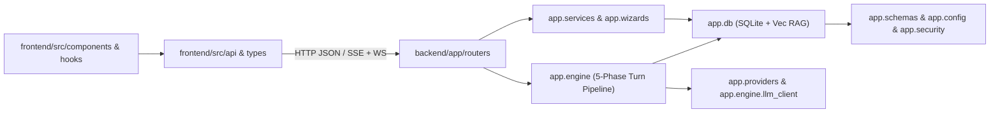

# CyberCantina Architecture Reference

Generated deterministically by `scripts/generate_arch_docs.py`. Start here for fast codebase orientation before reading implementation files.

## Quick Links

- [Backend Module Graph](BACKEND_GRAPH.md) — `tach.toml` domain boundaries & Mermaid graph
- [Frontend Module Graph](FRONTEND_GRAPH.md) — `dependency-cruiser` TS/React buckets & rules
- [Cross-Layer API, Schema & Module Map](CROSS_LAYER_MAP.md) — FastAPI routes paired with `frontend/src/api/*.ts`, SQLite ER diagram, and per-file package index

## Runtime Layer Overview

## 5-Phase Turn Pipeline (`backend/app/engine/`)

1. **Phase 1 (`phase1_pre.py` / `choices.py`)**: Spatial/mechanics intent analysis, d20 dice resolution, and character choice evaluation.
2. **Phase 2 (`phase2_context.py` -> `context/`)**: 4-Zone KV-cache prompt assembly (`zone1_static`, `zone2_episodic` LOD + vector recall, `zone3_history` `@Character` epistemic filter, `zone4_ephemeral` turn state).
3. **Phase 3 (`phase3_cognition.py` -> `cognition/` + `phase3_actor.py`)**: Private `<cognition>` thought generation per present character.
4. **Phase 4 (`phase4_prose.py`)**: Character/Narrator in-character prose streaming over SSE.
5. **Phase 5 (`phase5_clerk.py` -> `clerk/` + `character_agent.py` -> `char_agent/`)**: Async post-turn memory extraction, CARE-v1 affective integration (`affective/`), inventory lock arbitration, gossip propagation, and episodic compaction.

## Canonical Packages vs. Compatibility Facades

New domain logic belongs in the decomposed subpackages; root facades remain thin re-export & `monkeypatch` seams for existing tests:

| Canonical Subpackage / Directory | Compatibility Facade / Barrel |
| :--- | :--- |
| `backend/app/db/repos/` | `backend/app/db/repository.py` |
| `backend/app/db/vector_math.py` | `backend/app/db/vector_store.py` |
| `backend/app/engine/affective/` | `backend/app/engine/affective_engine.py` |
| `backend/app/engine/context/` | `backend/app/engine/phase2_context.py` |
| `backend/app/engine/cognition/` | `backend/app/engine/phase3_cognition.py` |
| `backend/app/engine/char_agent/` | `backend/app/engine/character_agent.py` |
| `backend/app/engine/clerk/` | `backend/app/engine/phase5_clerk.py` |
| `backend/app/routers/campaign_routes/` | `backend/app/routers/campaigns.py` |
| `backend/app/wizards/char_gen/` | `backend/app/wizards/character_wizard.py` |
| `frontend/src/types/` | `frontend/src/types/index.ts` |
| `frontend/src/api/` | `frontend/src/api/index.ts` |
| `frontend/src/components/{auth,character,chat,inspector,map,wizard,world}/` | `EntityEditorModals.tsx`, `WizardModals.tsx` |

## Verification & Regeneration Commands

- Regenerate architecture docs: `backend/.venv/bin/python scripts/generate_arch_docs.py`
- Verify freshness (non-zero if stale): `backend/.venv/bin/python scripts/generate_arch_docs.py --check`
- Backend lint + architecture boundaries + tests:
  - `cd backend && .venv/bin/ruff check app tests`
  - `cd backend && .venv/bin/tach check`
  - `backend/.venv/bin/pytest backend/tests`
- Frontend architecture boundaries + build + tests:
  - `npm --prefix frontend run arch:check`
  - `npm --prefix frontend run build && npm --prefix frontend test`
