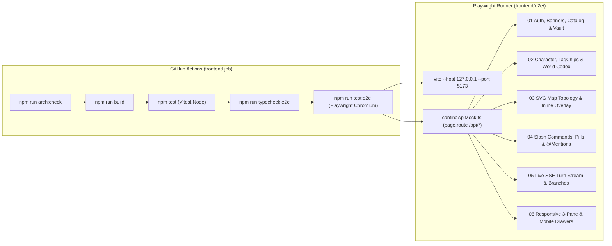

# Implementation Plan & Verification Matrix
## Frontend Playwright End-to-End (E2E) Browser Smoke Suite (`v0.22.0`)

## 1. Goal & Architecture Overview
Implement the 6-spec Playwright end-to-end browser smoke test suite specified in [FRD.md](file:///home/diegolima/Git/cybercantina/docs/features/0.22.0-playwright-e2e-smoke-suite/FRD.md).

CyberCantina's existing frontend tests run Vitest in a Node-only environment using `ReactDOMServer.renderToStaticMarkup(...)`. Adding a focused headless Chromium Playwright suite under `frontend/e2e/` provides real browser verification for stateful React lifecycles, DOM/SVG pointer and keyboard interactions, screen-space map inline overlays, composer `/` and `@` autocomplete popovers, live SSE turn streaming (`ReadableStream`), browser-resident credential storage, and responsive viewport media queries—without slowing down `npm test` or altering `docs/architecture/` generation.

---

## 2. Component & File Changes

### 2.1 Frontend Tooling, Vitest Isolation & Playwright Configuration
- **[MODIFY] [`frontend/package.json`](file:///home/diegolima/Git/cybercantina/frontend/package.json)**: Add `@playwright/test` to `devDependencies` and expose `test:e2e`, `test:e2e:ui`, and `typecheck:e2e` scripts.
- **[MODIFY] [`frontend/vite.config.ts`](file:///home/diegolima/Git/cybercantina/frontend/vite.config.ts)**: Configure `test.include: ["src/**/*.test.{ts,tsx}"]` and `test.exclude: ["e2e/**", "node_modules/**", "dist/**"]` so `vitest run` never loads Playwright specs.
- **[NEW] [`frontend/tsconfig.e2e.json`](file:///home/diegolima/Git/cybercantina/frontend/tsconfig.e2e.json)**: Dedicated TypeScript project config covering `playwright.config.ts` and `e2e/**/*.ts` without expanding `tsconfig.json`'s `"include": ["src"]`.
- **[NEW] [`frontend/playwright.config.ts`](file:///home/diegolima/Git/cybercantina/frontend/playwright.config.ts)**: Headless Chromium runner with `1440×900` default viewport, trace-on-failure, screenshot-on-failure, and automatic Vite dev server startup on `http://127.0.0.1:5173`.
- **[MODIFY] [`.gitignore`](file:///home/diegolima/Git/cybercantina/.gitignore)**: Ignore `frontend/playwright-report/` and `frontend/test-results/`.

### 2.2 Shared Stateful API & SSE Interception Harness
- **[NEW] [`frontend/e2e/fixtures/cantinaApiMock.ts`](file:///home/diegolima/Git/cybercantina/frontend/e2e/fixtures/cantinaApiMock.ts)**:
  - Intercepts `/^https?:\/\/[^/]+\/api(\/|\?|$)/` (avoiding Vite module imports under `/src/api/*.ts`).
  - Attaches an automatic `page.on("pageerror", ...)` listener asserting zero uncaught React runtime exceptions.
  - Pre-seeds realistic in-memory fixtures (*The Green Lie*, *Kira Vance*, *Yulia Halim*, *Operation Glass Horizon*) and framed `text/event-stream` SSE responses for `POST /api/campaigns/{id}/turns/stream`.

### 2.3 The 6 Playwright E2E Smoke Specifications
- **[NEW] [`frontend/e2e/01-auth-and-home-catalog.spec.ts`](file:///home/diegolima/Git/cybercantina/frontend/e2e/01-auth-and-home-catalog.spec.ts)**: Login gate validation, password visibility toggle, login/home admin announcement banners, catalog search filtering, 3-step `NewCampaignModal` launch, and browser credential vault persistence in `localStorage` without sending `bearer_token` to the server.
- **[NEW] [`frontend/e2e/02-character-and-world-authoring.spec.ts`](file:///home/diegolima/Git/cybercantina/frontend/e2e/02-character-and-world-authoring.spec.ts)**: `CharacterInspectorModal` editing, `TagChipsInput` multi-word space preservation (`"cybernetic arm"`), `Enter` / `,` / `Backspace` chip lifecycle, `+ Add Equipped` inventory items, and `WorldCodexTab` global search + lore creation (`PUT /api/worlds/world_green_lie`).
- **[NEW] [`frontend/e2e/03-spatial-topology-map-editor.spec.ts`](file:///home/diegolima/Git/cybercantina/frontend/e2e/03-spatial-topology-map-editor.spec.ts)**: SVG canvas node selection, starting-location deletion block notice, input-focus guard on global `Delete` key, screen-space HTML inline distance editor overlay (`[data-layer="inline-edge-editor"]`), hover `"X"` quick-delete on edge distance badges, and single-snapshot `Undo`.
- **[NEW] [`frontend/e2e/04-slash-commands-and-mentions.spec.ts`](file:///home/diegolima/Git/cybercantina/frontend/e2e/04-slash-commands-and-mentions.spec.ts)**: Stage-1 `/` command autocomplete (alphabetical order & line-1 index-0 anchor guard), inline command pill commit, Stage-2 `/party` subcommand selection, `@` handoff to `CharacterMentionPicker`, atomic `Backspace` at index `0`, hard-block `role="alert"` on unknown `/halp`, and `/help` tray click-to-insert.
- **[NEW] [`frontend/e2e/05-campaign-turn-sse-and-branches.spec.ts`](file:///home/diegolima/Git/cybercantina/frontend/e2e/05-campaign-turn-sse-and-branches.spec.ts)**: Turn 0 `StandaloneArrivalCard` expansion, sibling branch swipe switching (`v1` / `v2`), composer draft stashing & restoration on Turn Edit cancel (`Escape`), live SSE turn streaming, and collapsible character cognition drawers.
- **[NEW] [`frontend/e2e/06-responsive-campaign-layout.spec.ts`](file:///home/diegolima/Git/cybercantina/frontend/e2e/06-responsive-campaign-layout.spec.ts)**: Desktop (`1440×900`) 3-pane docked layout, sidebar icon-rail collapse/expand, `PartyManagementModal` & `NotesFlyout` toggles, and mobile (`390×844`) slide-over navigation and inspector drawers with `Escape` dismissal.

### 2.4 Continuous Integration Gate
- **[MODIFY] [`.github/workflows/ci.yml`](file:///home/diegolima/Git/cybercantina/.github/workflows/ci.yml)**: Install Playwright Chromium in the `frontend` job, run `npm --prefix frontend run typecheck:e2e && npm --prefix frontend run test:e2e`, and upload Playwright reports/traces on failure.

---

## 3. Task Checklist

- [x] **Task 1**: Author `FRD.md`, `REVIEW.md`, and `PLAN.md` in `docs/features/0.22.0-playwright-e2e-smoke-suite/`.
- [x] **Task 2**: Install `@playwright/test` and Chromium; configure `frontend/package.json`, `frontend/vite.config.ts`, `frontend/tsconfig.e2e.json`, `frontend/playwright.config.ts`, and `.gitignore`.
- [x] **Task 3**: Implement deterministic stateful API & SSE interception harness `frontend/e2e/fixtures/cantinaApiMock.ts`.
- [x] **Task 4**: Implement `01-auth-and-home-catalog.spec.ts` (Auth screen, admin banners, catalog filtering, new campaign launch, and browser credential vault).
- [x] **Task 5**: Implement `02-character-and-world-authoring.spec.ts` (`CharacterInspectorModal`, `TagChipsInput` multi-word space preservation & keyboard chip lifecycle, `+ Add` inventory/lore, and `WorldCodexTab`).
- [x] **Task 6**: Implement `03-spatial-topology-map-editor.spec.ts` (`SpatialTopologyView` node selection, screen-space HTML inline distance editor overlay, input-focus `Delete` guard, hover `"X"` quick-delete, block notice, and single-snapshot `Undo`).
- [x] **Task 7**: Implement `04-slash-commands-and-mentions.spec.ts` (Stage-1 `/` autocomplete, line-1 anchor guard, inline command pills, Stage-2 `/party` subcommands, `@` mention handoff, atomic `Backspace` at index 0, hard-block alert on `/halp`, and `/help` tray).
- [x] **Task 8**: Implement `05-campaign-turn-sse-and-branches.spec.ts` (Live SSE turn streaming, collapsible cognition drawers, first-visit arrival description cards, edit draft stashing, and branch checkout).
- [x] **Task 9**: Implement `06-responsive-campaign-layout.spec.ts` (Desktop `1440×900` 3-pane layout, `PartyManagementModal` & `NotesFlyout` dismissal, and mobile `390×844` slide-over drawers).
- [x] **Task 10**: Integrate Playwright E2E gate into `.github/workflows/ci.yml` and run all verification checks.

---

## 4. Verification Matrix

| Gate | Command | Status |
| :--- | :--- | :--- |
| **E2E Typecheck** | `npm --prefix frontend run typecheck:e2e` | Passed (`0` errors) |
| **Playwright Smoke Suite** | `npm --prefix frontend run test:e2e` | Passed (`6` specs, `12` tests in `~2.3s`) |
| **Frontend Architecture** | `npm --prefix frontend run arch:check` | Passed (`179` modules, `0` violations) |
| **Frontend Production Build** | `npm --prefix frontend run build` | Passed |
| **Frontend Vitest Suite** | `npm --prefix frontend test` | Passed (`30` files, `208` tests) |
| **Backend Ruff & Tach** | `cd backend && .venv/bin/ruff check app tests && .venv/bin/tach check` | Passed |
| **Architecture Docs Check** | `backend/.venv/bin/python scripts/generate_arch_docs.py --check` | Passed (`4` files verified) |
| **Backend Pytest Suite** | `cd backend && .venv/bin/pytest -n auto tests` | Passed (`472` passed) |
