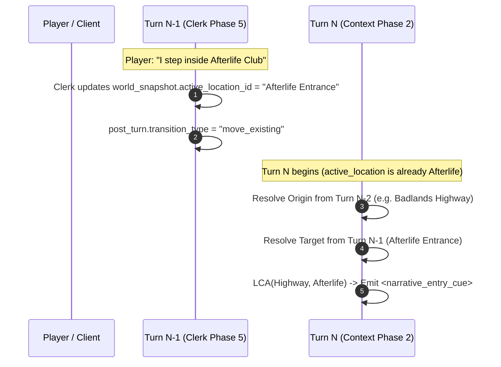

# Feature Requirements Document (FRD)
## Tiered Hierarchical Map Location Containers (Levels 0–4)

**Status:** Approved  
**Target Version:** CyberCantina v0.9.0  
**Author:** Pair-Programming Session  
**Scope:** Backend (`schemas`, `repository`, `phase2_context`, `phase5_clerk`), Frontend (`SpatialTopologyView`, `EntityEditorModals`, `LiveInspector`), Database (`schema.sql`, migrations), Documentation (`cybercantina-wiki`).

---

## 1. Executive Summary & Problem Statement

### 1.1 Problem Statement
As CyberCantina campaigns and world maps expand, the spatial graph becomes a dense, flat web of rooms, alleys, and corridors. This creates three critical friction points:
1. **Visual Clutter & Cognitive Overload:** The 2D compass-repulsion topology map (`SpatialTopologyView`) struggles to render large numbers of interconnected nodes legibly without overlapping lines or sprawling layouts.
2. **Lack of Geographic Context in Prompting:** While the AI is fed room-level descriptions (`<active_location>`), it lacks high-level regional ambiance (e.g., distinguishing an apartment inside a neon-lit cyberpunk mega-building from a farmhouse in a rural province) unless authors duplicate that text across every individual room or inflate World Macro Lore.
3. **RAG vs. Context Window Dilemma:** Unstructured regional lore either inflates Zone 1/Zone 2 token budgets globally or gets missed if disconnected from the active room.

### 1.2 Proposed Solution
Introduce a **0-to-4 Tiered Hierarchical Container System**:
* **Level 0 (Location Nodes):** The existing atomic graph rooms where gameplay, movement, and character presence occur.
* **Level 1 (Immediate Containers):** Buildings, dungeons, cave systems, or compounds that hold Level 0 locations. Level 1 containers can hold scoped regional lore, environmental tags, and ambiance, and enforce strict entry/exit portal rules.
* **Levels 2–4 (Macro Organizational Supernodes):** Districts (Level 2), Cities/Regions (Level 3), and Nations/Planets/Realms (Level 4). These are **strictly organizational** supernodes with names and descriptions (no lore entries), used for drill-down map navigation and compact hierarchical breadcrumb injection in LLM prompts.

```mermaid
graph TD
    subgraph Level4 ["Level 4: Macro Realm / Planet (Organizational)"]
        L4["Earth / Sol System"]
    end

    subgraph Level3 ["Level 3: City / Region (Organizational)"]
        L3["Night City Outskirts & Metro"]
    end

    subgraph Level2 ["Level 2: Region / District (Organizational)"]
        L2["Badlands District"]
    end

    subgraph Level1 ["Level 1: Immediate Container (Ambiance + Scoped Lore)"]
        L1["Afterlife Club (Container)<br/><i>Ambiance + Regional Lore Candidates</i>"]
    end

    subgraph Level0 ["Level 0: Physical Graph Nodes (Gameplay & Edges)"]
        R1["Entrance / Airlock<br/><b>[Entry/Exit Portal]</b>"]
        R2["Main Bar"]
        R3["VIP Lounge"]
        ROAD["Badlands Highway 101<br/><b>[Direct Child of Level 2 Region]</b>"]
    end

    L4 --> L3
    L3 --> L2
    L2 --> L1
    L2 -.->|Directly Contains (Loose Location)| ROAD
    L1 -.->|Wraps| R1
    L1 -.->|Wraps| R2
    L1 -.->|Wraps| R3

    ROAD <==>|Cross-Boundary Edge| R1
    R1 <-->|Internal Edge| R2
    R2 <-->|Internal Edge| R3
```

---

## 2. Core Architectural Principles & Guardrails

> [!IMPORTANT]
> **Mechanics Remain Strictly Flat (Level 0 $\to$ Level 0):**  
> Characters, inventory, dice checks, and movement transitions operate *exclusively* between Level 0 `LocationNode` records (`from_location_id -> to_location_id`). Containers form a **tree overlay** over the flat room graph; characters never "stand" inside an abstract Level 2 container.

1. **Strict 4-Zone KV-Cache Economy:**  
   * Organizational supernodes (Levels 2–4) **cannot contain lore entries**. They only inject concise breadcrumb strings into Zone 4 (`<hierarchy>Nation > City > District > Building</hierarchy>`), costing under 20 tokens.
   * Scoped lore injection is strictly limited to **Level 1** containers, subject to the same relevance scoring and secret gating caps as location lore.
2. **Elastic "Folders & Files" Membership:**  
   * Containers behave like a directory tree: a container at depth $D$ can contain both sub-containers ($< D$) and direct Level 0 locations ("loose files").
   * Forcing creators to invent synthetic Level 1 wrappers just to place an open highway, mountain pass, or forest clearing inside a Level 2 Region is explicitly avoided.
3. **Zero Breaking Changes to World Wizard Generation:**  
   * The World Wizard continues generating flat Level 0 location graphs to protect local LLM constrained JSON schemas. Containers are authored or wrapped post-generation in the World Sheet editor.
4. **Lowest Common Ancestor (LCA) Entry Cues:**  
   * When players cross container boundaries, an ephemeral instruction is injected into Zone 4 (not persisted in `user_message`) prompting the LLM to briefly depict arriving in the newly entered container(s).

---

## 3. Detailed Tier Specifications

| Level | Type | Permitted Children | Can Contain Lore? | Cross-Boundary Edges Allowed? | Primary Purpose |
| :--- | :--- | :--- | :--- | :--- | :--- |
| **0** | **Location Node** | *None (Atomic leaf)* | Yes (`LocationNode.lore_nodes`) | Only via `is_entry_exit = true` | Physical gameplay, spatial edges, character presence. |
| **1** | **Immediate Container** | Level 0 Locations | **Yes** (Scoped `lore_nodes`) | Enforces boundary routing | Regional ambiance, building/dungeon boundaries, scoped lore. |
| **2** | **District / Sub-area** | Level 1 Containers **and/or** direct Level 0 Locations | **No** (Name & description only) | N/A (Organizational) | Grouping Level 1 containers + transit roads/wilderness, map zoom clustering. |
| **3** | **City / Region** | Level 1–2 Containers **and/or** direct Level 0 Locations | **No** (Name & description only) | N/A (Organizational) | Macro regional clustering, inter-city highways, breadcrumb hierarchy. |
| **4** | **Realm / Planet / Realm** | Level 1–3 Containers **and/or** direct Level 0 Locations | **No** (Name & description only) | N/A (Organizational) | Top-level realm boundaries, orbital waypoints, world overview. |

> [!NOTE]
> **Elastic Depth:** Depth is non-mandatory. A small world may have standalone Level 0 rooms (uncontained), or a single Level 1 container (e.g. `Abandoned Station`) with no Level 2–4 parents. A location can sit directly in Level 2 (e.g. `Badlands Highway`) while neighboring locations sit inside a Level 1 container (`Afterlife Club`).

---

## 4. Graph & Boundary Mechanics (Level 1)

### 4.1 Entry/Exit Portals & Assistive Promotion
* **Mandatory for Level 1 Containers:** Enclosed physical structures (buildings, dungeons, cave networks, compounds) strictly enforce boundary containment: each Level 1 container must have **at least one** direct child location designated as an entry/exit portal (`is_entry_exit = true`) to connect outside.
* **Exemption for Loose Nodes in Macro Containers (Level 2+):** Loose transit locations situated directly inside Level 2+ macro containers (e.g., an open highway or mountain pass in `Badlands District`) connecting to other loose locations or across district borders connect freely without requiring artificial portal designations.
* **Generalized Boundary Rule:** An edge between location $A$ (in immediate container $C_A$) and location $B$ (in container $C_B$) crosses $C_A$'s boundary if $B$ is **not inside $C_A$ or any of $C_A$'s descendant sub-containers**.
  * *Example:* If `Bar` and `City Gates` are inside `City` (Level 1), and `Road` is directly inside `Region A` (Level 2, parent of `City`), then `City Gates <-> Road` crosses `City`'s boundary—so `City Gates` must be `is_entry_exit = true`. However, `Road` does **not** leave `Region A`, because `City` is inside `Region A`!
* **Dual Level 1 Container Boundary Promotion:** When an edge connects Location $A$ (inside Level 1 Container $C_A$) to Location $B$ (inside Level 1 Container $C_B$), the edge crosses the boundary of $C_A$ **and** the boundary of $C_B$. The validation check and assistive prompt must check and auto-promote **both** endpoints to `is_entry_exit = true`.
* **Zero-Portal Containers Invariant Clarification:** The entry/exit portal requirement is enforced **strictly on cross-boundary edges**, never as an unconditional constraint on the container record itself. Empty containers (supporting top-down worldbuilding before rooms are created) and isolated/secret complexes with no exterior paths are 100% valid with zero portals.
* **Assistive Promotion on Edge Creation:** When a creator draws or defines an edge that crosses out of a Level 1 container from an interior location not yet marked as an entry/exit portal:
  * The system **prompts the user to auto-promote** the interior node(s): *"Node '{location_name}' is inside container '{container_name}'. Mark it as an Entry/Exit portal and connect?"*
  * Confirming updates `is_entry_exit = true` and creates the edge in a single atomic transaction.
  * Internal edges between locations in the *same* container (or between a parent container's loose location and a child container's entry portal) connect freely without unnecessary friction.

### 4.2 "Convert Location to Wrapper Container" Flow (World Editor Operation)
> [!NOTE]
> **Scope Boundary:** "Convert to Container" and container hierarchy management are **strictly World Sheet Editor operations**. Containers are world-level structural records without turn IDs. In active campaigns, players interact with containers via inheritance during exploration and Copy-on-Write lore overrides.

When an author selects an existing Location Node $L$ and clicks **"Convert to Container"** in the World Sheet editor:
1. A modal prompts the user with:
   * **Container Name & Description:** Defaults to $L$'s current name and description.
   * **Portal Location Name:** Defaults to `"{L.name} — Entrance"` (or retaining original name).
   * **Lore Migration Option:** Checkbox: *"Migrate existing location lore to Level 1 container scope?"*
     * If checked, moves $L$'s `lore_nodes` to the new container (`container_id = new_container.id, location_id = NULL`), making that lore accessible throughout all interior rooms added later.
     * If unchecked, keeps the lore strictly attached to the entrance portal room.
2. A new Level 1 `LocationContainer` is created with:
   * `name`: Container name chosen above.
   * `description`: Container description chosen above.
   * `environmental_tags`: Inherited from $L$.
3. Node $L$ remains a Level 0 location, renamed if specified, assigned `container_id = new_container.id` and `is_entry_exit = true`.
4. All existing edges and active campaign turn state snapshots referencing $L.id$ remain 100% valid with zero breaking changes or ID remapping.

### 4.3 Assignment, Removal & Boundary Invariants
1. **Assigning a Connected External Node to a Container:**
   * If an external node connected to the container is moved inside, it automatically inherits `container_id`.
   * If it still maintains edges to outside nodes, it is automatically marked as `is_entry_exit = true`.
2. **Removing a Node from a Container & Empty Container Support:**
   * Containers may contain **0 locations** (supporting top-down worldbuilding: e.g. creating `Planet` $\to$ `City` $\to$ `Building` before adding rooms).
   * Removing a location from a container is always permitted. If removing node $L$ leaves internal edges to remaining interior nodes $M$, node $M$ is auto-promoted to an entry/exit portal to preserve boundary rules.
3. **Deletion Safety & Level 1 Lore Disposal Invariant:**
   * In SQLite DDL, `parent_container_id` uses `ON DELETE CASCADE` so world deletions (`DELETE FROM worlds WHERE id = ?`) and entity pruning cascades execute cleanly without SQLite foreign key visit-order deadlock.
   * At the **application / repository API level** (`delete_location_container`), deleting a container that contains child containers or locations is rejected unless the author explicitly specifies a `reassign_to_container_id` or confirms unparenting all children to the root.
   * **Level 1 Container Lore Disposal Invariant:** Because macro containers ($\text{depth} \ge 2$) strictly disallow lore (`validate_lore_depth` raises `ValueError`), Level 1 container lore can only be reassigned to target containers that have `depth == 1`. If child locations are unparented to root or reassigned to a macro container ($\text{depth} \ge 2$), the UI and API require the creator to choose:
     * Either **delete the container lore**, or
     * **Convert non-secret entries into World Lore** (`location_id = NULL, container_id = NULL`), with any secret entries securely pruned to avoid exposing un-gated secrets at the world level.
4. **Disconnected Graph & Multi-Realm Support:**
   * Global undirected connectedness to `starting_hub` is **not required**. Worlds may contain disjoint planetary topologies, parallel planes, or fast-travel transit networks with no physical walking paths between them.

### 4.4 Improvised Exploration during Gameplay
When a player explores into unknown territory (`pre_turn.spatial_intent == "explore_new"`):
* **Default Interior Rule:** If exploring from an interior room, the newly created location generated by Phase 5 Clerk (`add_improvised_location`) automatically inherits the active location's `container_id`.
* **Deterministic Exterior Detection via Structured Output:** Relying on fuzzy regex heuristics on narrative text ("step outside", "push open the door") is brittle on local models and violates the project rule: *Prefer deterministic post-processing over fuzzy prompt heuristics*. Instead, an explicit structured field is added to [`ImprovisedLocationSpec`](file:///home/diegolima/Git/cybercantina/backend/app/schemas/turn.py#L339-L358):
  ```python
  is_exterior: bool = Field(
      default=False,
      description="True if the newly explored location is outside the current building/compound; False if exploring deeper inside.",
  )
  ```
  If exploring from an active location with `is_entry_exit == True` and Phase 5 Clerk outputs `spec.is_exterior == True`, the improvised location is assigned the **parent container** of the active container (or `None` if the active container sits at the world root). If `spec.is_exterior == False`, the new location inherits the active container's `container_id`.
* **End-to-End Field Synchronization for `is_exterior`:**
  In accordance with project architecture guidelines, adding `is_exterior` synchronizes across all layers:
  1. `DEFAULT_CLERK_POST_TURN_SYSTEM` in [`backend/app/prompts/defaults.py#L221`](file:///home/diegolima/Git/cybercantina/backend/app/prompts/defaults.py#L221) is updated to describe `- is_exterior (boolean): true if the newly accessed area is outside the current building/compound; false if exploring deeper inside.`
  2. The offline heuristic fallback generator `_heuristic_spatial_and_inventory_delta` in [`backend/app/engine/phase5_clerk.py#L989`](file:///home/diegolima/Git/cybercantina/backend/app/engine/phase5_clerk.py#L989) is updated to instantiate `is_exterior=False`.
  3. Structured completion decoders pass explicit `required_properties` ensuring constrained local LLMs do not omit the key.

### 4.5 Cross-Boundary Edge Authoring in Drill-Down Views
When an author drills down into a container on `SpatialTopologyView`, external locations are hidden from the primary viewport to maintain focus. Cross-boundary connections are created through two complementary workflows:
1. **From Within the Container (Portal Details Panel):**
   * Selecting an Entry/Exit portal opens a **"Connect to External Location..."** action.
   * This displays a hierarchical, searchable modal grouped by container: `[Macro Region] > [City] > [Location Name]`.
2. **From the Outer Macro View (Supernode Targeting):**
   * When dragging an edge from an external location to a container supernode (e.g. `Badlands Highway` $\to$ `Afterlife Club` supernode), the UI prompts: *"Connect to which portal inside Afterlife Club? [Entrance / Airlock]"*.
   * **Supernode Targeting when Container has 0 Portals:** If the targeted container has no portals designated yet, the selection modal allows the creator to select **any** room inside the container, automatically marking the chosen room as an entry/exit portal upon connecting.
3. **Directed Edges:** `LocationEdge` is directed (`from_location_id -> to_location_id`). Marking a node as an Entry/Exit portal permits it to act as source or target for cross-boundary edges; visual arrows clearly indicate traversal direction.

### 4.6 Live Campaign Mid-Turn Location & Edge Creation
CyberCantina enables directors and players to create linked locations and edges mid-campaign:
1. **Linked Location Creation (`create_linked_location`):** When creating a new room from an active room inside a container, the new room automatically inherits the parent room's `container_id`.
2. **Campaign Edge Creation & Base World Immutability (`connect_campaign_locations`):** If linking two existing locations across container boundaries mid-campaign, mutating base world rows (`location_nodes.is_entry_exit = 1`) directly would leak changes to other campaigns using the same world and break timeline rollbacks on turn rewinds/swipes.  
   Instead, campaign bundles dynamically resolve portal status across the active branch:
   ```python
   is_portal = loc.is_entry_exit or any(
       edge.is_cross_boundary for edge in active_branch_edges if edge.connects_to(loc.id)
   )
   ```
   This ensures timeline rewind safety (`delete_last_turn`) removes dynamic portal status automatically without requiring an extra DB override table or mutating base world records.
3. **8-Neighbor Overflow Passage Hubs:** When `create_linked_location` or improvised exploration encounters an 8-neighbor cap, the synthetic connecting passage hub automatically inherits the current room's `container_id`. If any edge rewired to the new Passage Hub crosses a container boundary, the Passage Hub **must automatically be created with `is_entry_exit = True`** to ensure external connections remain valid.

---

## 5. Prompt Engine & LLM Context Integration

### 5.1 Zone 4 Context Frame Injection
In [`build_zone4_ephemeral_tail_frame`](file:///home/diegolima/Git/cybercantina/backend/app/engine/phase2_context.py#L1562-L1928), the `<active_location>` block is enriched with the hierarchical breadcrumb and immediate container ambiance:

```xml
<scene_context>
  ...
  <active_location name="VIP Lounge">
    <spatial_hierarchy>Earth > Night City > Watson District > Afterlife Club</spatial_hierarchy>
    <parent_container name="Afterlife Club">
      Legendary mercenary club built in a repurposed subterranean mortuary. Heavy bass pulses through concrete floors, cutting through thick synth-smoke and neon haze.
      Atmosphere: subterranean, loud, crowded, fortified
    </parent_container>
    Props & Atmosphere: red velour curtains, private holo-terminal, armored glass
    <local_lore>
      ...
    </local_lore>
  </active_location>
  ...
</scene_context>
```

### 5.2 Scoped Level 1 Container Lore Selection & Live Campaign Copy-on-Write (CoW)
Container lore is injected via an extension to [`select_active_location_lore_for_turn`](file:///home/diegolima/Git/cybercantina/backend/app/engine/phase2_context.py#L507-L560):
1. **Candidate Gathering:** If the active location has a Level 1 container, gather `container.lore_nodes` (respecting active campaign CoW overrides if running inside a campaign).
2. **Relevance Scoring:** Run token/tag scoring against the user input, narrator directive, and entities.
3. **Secret Gating & Vector Indexing Safety:**
   * If a container lore entry is marked `secret`, require an explicit DC roll pass or explicit directive reveal in Phase 2.
   * **Strict Vector Secret Exclusion:** When indexing container lore into `vector_entries`, entries with `category == "secret"` **must be excluded** from vector embedding insertion (mirroring [`import_export_service.py#L593`](file:///home/diegolima/Git/cybercantina/backend/app/services/import_export_service.py#L593)), preventing semantic search in `search_memories_for_characters` from leaking undiscovered secrets into `<recalled_memories_and_lore>`.
4. **Phase 1 Entity Mention Gathering:** In [`_execute_turn_stream_events_unlocked`](file:///home/diegolima/Git/cybercantina/backend/app/routers/campaigns.py#L694-L720), append **all container display names** from `world.containers` and non-secret entity tags from **all** container lore across the world to `raw_known_entities`. This ensures Phase 1 Pre-Turn analysis reliably identifies player mentions of distant containers or regional landmarks (e.g., *"Let's head back to Afterlife Club"* or referencing an NPC/faction from district lore) even when standing outside in a different location.
5. **Tight Budget Cap:** Ambient container lore is capped at **max 2 entries** per turn (preventing displacement of room-level lore or working memory).
6. **RAG Exclusion:** When querying the vector store for cross-world episodic memories via `search_memories_for_characters`, supply `exclude_container_id = active_location.container_id` so container lore is not redundantly fetched via vector search.
7. **Live Campaign Copy-on-Write (CoW) & Vector Secret Safety:**
   * Just like `campaign_location_lore_overrides`, players can atomically edit or enrich Level 1 container lore on the active timeline branch without modifying the underlying base world record.
   * Modifying container lore during a campaign records an entry in `campaign_container_lore_overrides`, inserts branch-isolated `LoreNode` entries stamped with `campaign_id`, and indexes them into the vector store under that campaign.
   * **Strict Campaign Vector Secret Exclusion:** In `PUT /api/campaigns/{id}/containers/{cid}/lore`, vector embedding batch-upsertion must enforce `if node.category != "secret"`, guaranteeing campaign-scoped container secrets never leak into `vector_entries` or semantic RAG recall pools.

### 5.3 Boundary-Crossing Entry & Exit Cues (LCA Calculation & Turn Timing)
To fulfill the requirement of prompting the narrator/actor to describe a new region without mutating the persistent `user_message`:

1. **Deterministic Transition Detection & Turn Timing Resolution:**
   * **The Turn Timing Inversion Trap:** In CyberCantina, Phase 5 Clerk executes at the **end** of Turn $N-1$ and commits the new location into `completed_turn.world_snapshot.active_location_id` ([`phase5_clerk.py#L1797`](file:///home/diegolima/Git/cybercantina/backend/app/engine/phase5_clerk.py#L1797)). When Turn $N$ begins, `parent_turn` is Turn $N-1$, meaning `parent_turn.world_snapshot.active_location_id` is **already the destination**! If origin was resolved from `parent_turn.world_snapshot.active_location_id`, $\text{origin} == \text{destination}$, LCA delta would be empty, and arrival cues would never fire.
   * **Resolution Rule:**
     * When `parent_turn.post_turn and parent_turn.post_turn.transition_type in ("move_existing", "improvise_new")`:
       * **Destination:** `parent_turn.world_snapshot.active_location_id` (current `active_location`).
       * **Origin:** Grandparent turn's active location (`branch_turns[-2].world_snapshot.active_location_id`). If `len(branch_turns) < 2`, transition cues are suppressed.
     * When `req.override_location_id` is supplied:
       * **Destination:** `req.override_location_id`.
       * **Origin:** Resolved from `parent_active_loc_id` captured in [`campaigns.py#L652`](file:///home/diegolima/Git/cybercantina/backend/app/routers/campaigns.py#L652) *prior* to mutating `parent_turn.world_snapshot.active_location_id`. Resolving origin from the mutated snapshot causes $\text{origin} == \text{destination}$ and prevents arrival cues from firing during director location overrides.
   * **Turn 0 & Turn 1 Suppression:** On Turn 0 (campaign creation) and Turn 1 (player's first prompt), arrival cues are explicitly **suppressed**; the author's configured opening scene / character greeting already establishes the starting environment.



2. **LCA Calculation, Asymmetric Transitions & Entry Precedence:**
   * Let $P_{origin}$ and $P_{target}$ be the ordered list of ancestor container records from world root down to immediate parent container.
   * *Entering a nested sub-container:*
     $$P_{origin} = [\text{Earth}, \text{Night City}, \text{City Center}]$$
     $$P_{target} = [\text{Earth}, \text{Night City}, \text{Watson}, \text{Afterlife}]$$
     $$\text{Lowest Common Ancestor: } \text{Night City} \implies \text{Newly Entered: } [\text{Watson}, \text{Afterlife}]$$
   * *Exiting a Level 1 container onto an open Level 0 location in a Level 2 parent:*
     $$P_{origin} = [\text{Region A}, \text{City}] \quad (\text{Bar})$$
     $$P_{target} = [\text{Region A}] \quad (\text{Road})$$
     $$\text{Lowest Common Ancestor: } \text{Region A} \implies \text{Exited: } [\text{City}],\ \text{Entered: } \emptyset$$
   * **Entry Precedence Rule (Exit Cue Suppression):**  
     Whenever `Entered` is non-empty (e.g., transitioning between two Level 1 containers like `Afterlife Club` $\to$ `Lizzie's Bar`, or stepping into a building from outside), **suppress `<narrative_exit_cue>` entirely**. Emitting dual exit and entry instructions causes prompt confusion in 12B local models, wasting tokens re-narrating the departure rather than establishing immediate presence. `<narrative_exit_cue>` fires *only* when `Entered` is empty ($\text{Entered} = \emptyset$).
   * *Asymmetric LCA Rules when Exiting to World Root or Across Disjoint Trees ($\text{LCA} = \text{None}$):*
     * **Entering from World Root ($P_{origin} = \emptyset, P_{target} \neq \emptyset$):** Emit `<narrative_entry_cue>` for all containers in $P_{target}$.
     * **Exiting to World Root ($P_{origin} \neq \emptyset, P_{target} = \emptyset$):** Emit `<narrative_exit_cue>` for all origin containers in $P_{origin}$ being departed.
     * **Disjoint Trees ($P_{origin} \neq \emptyset, P_{target} \neq \emptyset, \text{LCA} = \text{None}$):** In cases of fast-travel, teleportation, or disjoint trees (e.g., `Earth > Night City` to `Moon Colony > Base Alpha`), emit `<narrative_entry_cue>` for all containers in $P_{target}$ and suppress exit cues per Entry Precedence.
3. **Ephemeral Prompt Directive Injection & Anti-Repetition Guidance:**  
   To prevent awkward re-narration if the player or actor already depicted walking through the doorway on the movement turn itself:
   * Container descriptions in cues are truncated to **$\le 200$ characters**.
   * Anti-repetition directives instruct the model to ground speech/action rather than repeating the threshold crossing:
   * **Entering a Container (`<narrative_entry_cue>`):**
     ```xml
     <narrative_entry_cue>
       The party is now inside {container.name} (hierarchy: {breadcrumb}).
       If arrival was already depicted on the previous turn, do NOT re-narrate walking through the entrance; ground dialogue and immediate reactions in the surroundings: {short_ambiance_200_chars}.
     </narrative_entry_cue>
     ```
   * **Exiting a Container (`<narrative_exit_cue>`):**
     ```xml
     <narrative_exit_cue>
       The party just exited {container.name} onto {location.name}.
       If departure was already depicted on the previous turn, do NOT re-narrate crossing the threshold; ground speech and actions in the immediate open environment: {short_ambiance_200_chars}.
     </narrative_exit_cue>
     ```
   * *Zero transcript pollution:* The user's chat bubble displays only what the player typed.
   * *Deterministic & single-pass:* Generated in the standard character/narrator response without an extra LLM call.

### 5.4 Phase 3 Cognition Swarm Environment Perception (Zone 1 KV-Cache Discipline)
In multi-agent cognition (`phase3_cognition.py`), characters formulate internal thoughts, emotional feelings, active wants, and tactical plans before narrative prose is written.
* **KV-Cache Preservation:** Zone 1 static system prompts must **never** be mutated on spatial transitions. Container ambiance and lore must strictly be injected into the dynamic `user_prompt` in [`run_character_cognition_agent`](file:///home/diegolima/Git/cybercantina/backend/app/engine/phase3_cognition.py#L811-L828) under `Scene Props & Fixtures` / `Environment Details`:
  ```text
  - Immediate Regional Surroundings ({container.name}): {container.description} [Atmosphere: {tags}]
  - Scene Props & Fixtures ({active_location.name}): {active_location.environmental_tags}
  ```
* **Effect:** Characters' inner monologues and emotional appraisals reflect the broader building or compound atmosphere without evicting the static Zone 1 KV-cache.

---

## 6. Database Schema & Data Models

### 6.1 Database Schema & Migration Strategy (`backend/app/db/schema.sql`, `backend/app/db/repository.py`)

#### Table Definitions
```sql
CREATE TABLE IF NOT EXISTS location_containers (
    id TEXT PRIMARY KEY,
    world_id TEXT NOT NULL REFERENCES worlds(id) ON DELETE CASCADE,
    parent_container_id TEXT NULL REFERENCES location_containers(id) ON DELETE CASCADE,
    depth INTEGER NOT NULL CHECK (depth BETWEEN 1 AND 4),
    name TEXT NOT NULL,
    description TEXT NOT NULL DEFAULT '',
    environmental_tags_json TEXT NOT NULL DEFAULT '[]',
    created_at TEXT NOT NULL
);

CREATE INDEX IF NOT EXISTS idx_location_containers_world ON location_containers(world_id);
CREATE INDEX IF NOT EXISTS idx_location_containers_parent ON location_containers(parent_container_id);

-- Alter existing location_nodes table
ALTER TABLE location_nodes ADD COLUMN container_id TEXT NULL REFERENCES location_containers(id) ON DELETE SET NULL;
ALTER TABLE location_nodes ADD COLUMN is_entry_exit INTEGER NOT NULL DEFAULT 0;

-- Alter existing vector_entries table to support scoped container lore isolation
ALTER TABLE vector_entries ADD COLUMN container_id TEXT NULL;
CREATE INDEX IF NOT EXISTS idx_vector_entries_container ON vector_entries(world_id, container_id, campaign_id);

-- Index for scoped container lore lookups on lore_nodes
CREATE INDEX IF NOT EXISTS idx_lore_nodes_container ON lore_nodes(container_id, campaign_id);

-- Copy-on-Write campaign override tracking for Level 1 container lore
CREATE TABLE IF NOT EXISTS campaign_container_lore_overrides (
    campaign_id TEXT NOT NULL REFERENCES campaigns(id) ON DELETE CASCADE,
    container_id TEXT NOT NULL REFERENCES location_containers(id) ON DELETE CASCADE,
    updated_at TEXT NOT NULL,
    PRIMARY KEY (campaign_id, container_id)
);
```

#### SQLite `lore_nodes` Table Recreation Migration
Existing `lore_nodes` in [`backend/app/db/schema.sql`](file:///home/diegolima/Git/cybercantina/backend/app/db/schema.sql#L223-L242) enforce a table-level `CHECK` constraint:
```sql
CHECK(
    category IN ('history', 'culture', 'faction', 'rumor', 'artifact', 'secret')
    AND (location_id IS NOT NULL OR category != 'secret')
    AND (location_id IS NULL OR category != 'artifact')
    AND (campaign_id IS NULL OR location_id IS NOT NULL)
)
```
Because SQLite does not allow altering `CHECK` constraints with `ALTER TABLE`, adding `container_id` would cause immediate `IntegrityError`s on container secrets (`location_id IS NOT NULL` fails) and campaign container lore overrides (`campaign_id IS NULL OR location_id IS NOT NULL` fails).

**Migration Procedure (`_migrate_lore_nodes_for_containers`):**
1. **Idempotency Guard:** Inspect table columns via `col_names = {r[1] for r in conn.execute('PRAGMA table_info(lore_nodes)').fetchall()}`. If `'container_id'` is already present, return immediately without executing table recreation.
2. Run under `PRAGMA foreign_keys = OFF;`.
3. Create `lore_nodes_new` strictly aligned with CyberCantina's existing schema columns (preserving strict tag validation):
   ```sql
   CREATE TABLE lore_nodes_new (
       id TEXT PRIMARY KEY,
       world_id TEXT NOT NULL REFERENCES worlds(id) ON DELETE CASCADE,
       location_id TEXT NULL REFERENCES location_nodes(id) ON DELETE CASCADE,
       container_id TEXT NULL REFERENCES location_containers(id) ON DELETE CASCADE,
       campaign_id TEXT NULL REFERENCES campaigns(id) ON DELETE CASCADE,
       title TEXT NOT NULL CHECK(length(trim(title)) >= 1),
       category TEXT NOT NULL CHECK(
           category IN ('history', 'culture', 'faction', 'rumor', 'artifact', 'secret')
           AND ((location_id IS NOT NULL OR container_id IS NOT NULL) OR category != 'secret')
           AND (location_id IS NULL OR category != 'artifact')
           AND (container_id IS NULL OR category != 'artifact')
           AND (campaign_id IS NULL OR location_id IS NOT NULL OR container_id IS NOT NULL)
           AND (location_id IS NULL OR container_id IS NULL) -- Mutually exclusive scope
       ),
       content TEXT NOT NULL CHECK(length(trim(content)) >= 1),
       entity_tags_json TEXT NOT NULL CHECK(
           json_valid(entity_tags_json)
           AND json_type(entity_tags_json) = 'array'
           AND json_array_length(entity_tags_json) >= 1
           AND entity_tags_json NOT LIKE '%""%'
       )
   );
   ```
4. Copy existing rows (`INSERT INTO lore_nodes_new ... SELECT id, world_id, location_id, NULL AS container_id, campaign_id, title, category, content, entity_tags_json FROM lore_nodes`).
5. Drop old table, rename `lore_nodes_new` to `lore_nodes`, recreate indexes, and re-enable `PRAGMA foreign_keys = ON;`.

#### Vector Store RAG Retrieval & Candidate Filtering (`backend/app/db/vector_store.py`)
To ensure container lore is recallable remotely while preventing duplicate entries in `<recalled_memories_and_lore>` or leaking overridden base world lore:
1. Index non-secret container lore under `source_type = 'container_lore'` with `container_id` populated in `vector_entries`.
2. **Explicit Column Selection Projection:** In both `VectorStore.search_memories` (lines 766–777) and `search_memories_for_characters` (lines 898–908), extend the candidate fetch SQL projection to explicitly include `container_id`:
   ```sql
   SELECT id, source_type, location_id, container_id, character_id, campaign_id, anchor_turn_id, superseded_at_turn_id, title, content, keywords_json, embedding_blob, embedding_fingerprint FROM vector_entries ...
   ```
   *(Without this explicit column projection, accessing `row["container_id"]` on the resulting SQLite `Row` raises a runtime `IndexError`).*
3. **Upsert Method Signatures:** Update parameter lists of [`upsert_entry`](file:///home/diegolima/Git/cybercantina/backend/app/db/vector_store.py#L381) and [`aupsert_entry`](file:///home/diegolima/Git/cybercantina/backend/app/db/vector_store.py#L450) to accept `container_id: str | None = None`.
4. **SQL Query Inclusion & Parameter Binding Synchronization:** In both `search_memories` and `search_memories_for_characters`, extend the candidate fetch SQL `WHERE` clause to include `container_lore`:
   ```sql
   OR (world_id = ? AND source_type = 'container_lore' AND (campaign_id IS NULL OR campaign_id = '' OR campaign_id = ?))
   ```
   *Binding Synchronization:* Because this clause adds two `?` placeholders (`world_id` and `campaign_id`), update the `params` tuple in both queries:
   - In `search_memories`: `(world_id, world_id, campaign_id, world_id, campaign_id, character_id, ...)`
   - In `search_memories_for_characters`: `(world_id, world_id, campaign_id, world_id, campaign_id, *char_set, campaign_id)`
   *(Failing to supply these bindings triggers `sqlite3.ProgrammingError: Incorrect number of bindings supplied`).*
5. **Relevance Floor Enforcement:** In `vector_store.py` (line 609), extend the candidate floor filter to cover `container_lore`:
   ```python
   if stype in ("location_lore", "container_lore") and entity_boost == 0.0 and overlap_count == 0 and cosine_sim < 0.35:
       continue
   ```
   *(Prevents distant, unrelated container lore from bypassing the semantic relevance floor).*
6. **Active Scope Exclusion:** In `search_memories_for_characters` and `search_memories`, accept `exclude_container_id: str | None = None` and skip candidate vector rows where `row["container_id"] == exclude_container_id`.
7. **Campaign Override Loading:** In `_load_overridden_location_ids`, extend the helper to query both `campaign_location_lore_overrides` and `campaign_container_lore_overrides` so campaign-modified container lore supersedes base world container lore in vector search.

#### Query Isolation in `CantinaRepository.get_world` (`backend/app/db/repository.py`)
In `get_world`, the macro lore query currently selects:
```sql
SELECT * FROM lore_nodes
WHERE world_id = ? AND location_id IS NULL AND campaign_id IS NULL
ORDER BY rowid ASC
```
Because container lore rows have `location_id IS NULL`, this query **must be updated** to:
```sql
SELECT * FROM lore_nodes
WHERE world_id = ? AND location_id IS NULL AND container_id IS NULL AND campaign_id IS NULL
ORDER BY rowid ASC
```
Container lore is populated into each `LocationContainer.lore_nodes` via a companion helper `_resolve_container_lore_map(conn, container_ids, campaign_id=...)`, preventing container lore from contaminating world-level lore validation.

---

### 6.2 Pydantic Schemas & Bundles (`backend/app/schemas/world.py`, `turn.py`)

```python
def _enforce_world_level_lore_nodes(nodes: list[LoreNode]) -> list[LoreNode]:
    """Ensure world-level lore nodes are not scoped to a location or container."""
    for node in nodes:
        if node.location_id is not None or node.container_id is not None:
            raise ValueError(
                "World-level lore_nodes must not set location_id or container_id; attach scoped lore to LocationNode or LocationContainer."
            )
        if node.category == "secret":
            raise ValueError("Category 'secret' is not allowed on world-level lore entries.")
    return nodes

class LoreNode(BaseModel):
    id: str
    world_id: str
    location_id: str | None = None
    container_id: str | None = None
    campaign_id: str | None = None
    title: str = Field(..., min_length=1, max_length=120)
    category: AnyLoreCategory
    content: str = Field(..., min_length=1, max_length=2000)
    entity_tags: list[str] = Field(..., min_length=1, max_length=20)

    @model_validator(mode="after")
    def _enforce_scope_invariants(self) -> "LoreNode":
        if self.location_id is None and self.container_id is None and self.category == "secret":
            raise ValueError("Category 'secret' is only allowed on location or container lore entries.")
        if (self.location_id is not None or self.container_id is not None) and self.category == "artifact":
            raise ValueError("Category 'artifact' is only allowed on world lore entries.")
        if self.campaign_id is not None and self.location_id is None and self.container_id is None:
            raise ValueError("Campaign-scoped lore overrides must belong to a specific location or container.")
        if self.location_id is not None and self.container_id is not None:
            raise ValueError("Lore entry cannot be scoped to both a location and a container.")
        return self

class LocationContainer(BaseModel):
    id: str
    world_id: str
    parent_container_id: str | None = None
    depth: int = Field(..., ge=1, le=4, description="1=Building/Complex, 2=District, 3=City/Region, 4=Planet/Realm")
    name: str
    description: str = ""
    environmental_tags: list[str] = Field(default_factory=list)
    lore_nodes: list[LoreNode] = Field(
        default_factory=list,
        description="Scoped lore entries (strictly allowed only on depth=1 containers)."
    )

    @model_validator(mode="before")
    @classmethod
    def _bind_nested_container_lore(cls, data: Any) -> Any:
        """Bind container_id and world_id to raw nested lore dicts before field validation runs."""
        if isinstance(data, dict) and isinstance(data.get("lore_nodes"), list):
            cont_id = data.get("id")
            w_id = data.get("world_id") or ""
            if cont_id:
                bound: list[Any] = []
                for idx, entry in enumerate(data["lore_nodes"]):
                    if isinstance(entry, dict):
                        patched = dict(entry)
                        patched["container_id"] = patched.get("container_id") or cont_id
                        patched["world_id"] = patched.get("world_id") or w_id
                        patched["location_id"] = None  # Enforce mutual exclusivity with location scope
                        patched["id"] = patched.get("id") or f"new_cont_lore_{idx}"
                        bound.append(patched)
                    elif isinstance(entry, LoreNode):
                        bound.append(entry.model_copy(update={"container_id": cont_id, "location_id": None}))
                    else:
                        bound.append(entry)
                data = {**data, "lore_nodes": bound}
        return data

    @model_validator(mode="after")
    def validate_lore_depth(self) -> "LocationContainer":
        if self.depth > 1 and self.lore_nodes:
            raise ValueError(f"Lore nodes are strictly forbidden on macro containers (depth={self.depth}). Lore is only allowed on Level 1 containers.")
        return self

class CampaignContainerLoreUpdatePayload(BaseModel):
    """Atomic Copy-on-Write Level 1 container lore replacement payload during an active campaign."""
    lore_nodes: list[LocationLoreNodeDraft] = Field(default_factory=list)

class LocationNode(BaseModel):
    id: str
    world_id: str
    created_at_turn_id: str | None = None
    container_id: str | None = None
    is_entry_exit: bool = False
    name: str
    summary: str
    description: str
    environmental_tags: list[str] = Field(default_factory=list)
    is_starting_location: bool = False
    is_hub: bool = False
    starting_message: str = ""
    lore_nodes: list[LoreNode] = Field(default_factory=list)

class ImprovisedLocationSpec(BaseModel):
    name: str
    summary: str
    description: str
    environmental_tags: list[str] = Field(default_factory=list)
    is_exterior: bool = Field(
        default=False,
        description="True if the newly explored location is outside the current building/compound; False if exploring deeper inside.",
    )

class WorldRecord(BaseModel):
    id: str
    name: str
    global_rules: WorldGlobalRules
    pending_deletion: bool = False
    created_at: str
    containers: list[LocationContainer] = Field(default_factory=list)
    locations: list[LocationNode] = Field(default_factory=list)
    edges: list[LocationEdge] = Field(default_factory=list)
    lore_nodes: list[LoreNode] = Field(default_factory=list)

    @field_validator("lore_nodes")
    @classmethod
    def _validate_world_lore(cls, v: list[LoreNode]) -> list[LoreNode]:
        return _enforce_world_level_lore_nodes(v)

    @model_validator(mode="after")
    def validate_container_hierarchy(self) -> "WorldRecord":
        c_by_id = {c.id: c for c in self.containers}
        # 0. Container world_id integrity
        for c in self.containers:
            if c.world_id and c.world_id != self.id:
                raise ValueError(f"Container '{c.name}' world_id '{c.world_id}' does not match world '{self.id}'.")
        # 1. Location container reference integrity
        for loc in self.locations:
            if loc.container_id and loc.container_id not in c_by_id:
                raise ValueError(f"Location '{loc.name}' references non-existent container '{loc.container_id}'.")
        # 2. Depth monotonicity (parent must be strictly higher level)
        for c in self.containers:
            if c.parent_container_id:
                if c.parent_container_id not in c_by_id:
                    raise ValueError(f"Container '{c.name}' references non-existent parent '{c.parent_container_id}'.")
                parent = c_by_id[c.parent_container_id]
                if parent.depth <= c.depth:
                    raise ValueError(f"Container '{c.name}' (depth {c.depth}) parent '{parent.name}' must have strictly higher depth (found {parent.depth}).")
        # 3. Cycle detection
        for c in self.containers:
            curr = c
            visited = set()
            while curr.parent_container_id:
                if curr.id in visited:
                    raise ValueError(f"Cycle detected in container hierarchy involving '{curr.name}'.")
                visited.add(curr.id)
                curr = c_by_id[curr.parent_container_id]
        return self

class WorldUpdatePayload(BaseModel):
    name: str
    global_rules: WorldGlobalRules
    containers: list[LocationContainer] = Field(default_factory=list)
    locations: list[LocationNode] = Field(default_factory=list)
    edges: list[LocationEdge] = Field(default_factory=list)
    lore_nodes: list[LoreNode] = Field(default_factory=list)

class CampaignStateBundle(BaseModel):
    campaign: CampaignRecord
    containers: list[LocationContainer] = Field(default_factory=list)
    visible_locations: list[LocationNode]
    visible_edges: list[LocationEdge]
    ...
```

* **Live Campaign Endpoint:** `PUT /api/campaigns/{campaign_id}/containers/{container_id}/lore` (validates `depth == 1`, executes Copy-on-Write override, updates vector embeddings, returns refreshed `CampaignStateBundle`).

---

### 6.3 State Synchronization, World Forking & Import/Export

1. **In-Place World Updates (`CantinaRepository.update_world` when `campaigns_using == 0`):**
   * When no active campaigns use the world, `update_world` deletes and updates records in-place within an atomic transaction:
     * Delete existing containers: `DELETE FROM location_containers WHERE world_id = ?` (executed in harmony with `location_nodes` deletions).
     * Handle temporary client container IDs (e.g. `new_cont_...`) by mapping them to clean `cont_{uuid}` identifiers in a `cont_id_map: dict[str, str]`.
     * Sort incoming containers topologically by `depth` descending (Level 4 down to Level 1) so parents are inserted before children.
     * **SQL INSERT Column Update:** In lines 2663–2682, update the `INSERT INTO location_nodes` statement to write `container_id` and `is_entry_exit`:
       ```sql
       INSERT INTO location_nodes (id, world_id, created_at_turn_id, container_id, is_entry_exit, name, summary, description, environmental_tags_json, is_starting_location, is_hub, starting_message)
       VALUES (?, ?, ?, ?, ?, ?, ?, ?, ?, ?, ?, ?)
       ```
     * Remap `location.container_id = cont_id_map.get(loc.container_id)`.
     * **Vector Entries Cleanup:** In lines 2646–2654, update the vector deletion statement to include `'container_lore'`:
       ```sql
       DELETE FROM vector_entries
       WHERE world_id = ?
         AND source_type IN ('lore', 'location_lore', 'container_lore')
         AND (campaign_id IS NULL OR campaign_id = '')
       ```
       preventing stale or deleted container lore from lingering as ghost embeddings in SQLite.
     * Vector Embedding Cache Reuse: Include `container_lore` in `existing_lore_blobs` (`SELECT ... WHERE source_type IN ('lore', 'location_lore', 'container_lore')`) to prevent unchanged container lore from triggering redundant embedding API calls.
2. **Silent World Forking (`CantinaRepository.update_world` when `campaigns_using > 0`):**
   * When editing a world with active campaigns, the repository silently forks the world into `target_world_id`.
   * **Container Remapping:**
     * Maintain `container_id_map: dict[str, str] = {}`.
     * Sort containers topologically by `depth` descending (Level 4 down to Level 1) to ensure parent containers are inserted and remapped before children.
     * Generate `new_cont_id = f"cont_{uuid.uuid4().hex[:10]}"`, remap `parent_container_id = container_id_map.get(old_parent_id)`, and insert into `location_containers`.
     * **SQL INSERT Column Update:** In lines 2744–2763, update the forked `INSERT INTO location_nodes` statement to write remapped `container_id = container_id_map.get(loc.container_id)` and `is_entry_exit`.
     * Clone all Level 1 container `lore_nodes` under the new `container_id` and re-index vector embeddings under `target_world_id`.
3. **Async Embedding Pre-Computation in `CantinaRepository.aupdate_world` (`repository.py#L2985-L3025`):**
   * Before persisting changes to SQLite, `aupdate_world` asynchronously batches embedding generations for new and modified lore.
   * In addition to scanning `payload.lore_nodes` and `loc.lore_nodes`, `aupdate_world` **must iterate through Level 1 containers**:
     ```python
     for cont in payload.containers:
         if cont.depth == 1:
             for l_node in cont.lore_nodes:
                 if l_node.category != "secret":
                     lore_candidates.append(l_node)
     ```
     extracting uncached container lore blobs and sending them to `vector_store.aupsert_entry`. This avoids slow synchronous fallbacks and guarantees container lore is immediately queryable via vector RAG after saving.
4. **ZIP Staged Import Service (`ImportExportService.commit_staged_import`):**
   * In `commit_staged_import` ([`backend/app/services/import_export_service.py#L472`](file:///home/diegolima/Git/cybercantina/backend/app/services/import_export_service.py#L472)), raw SQL insertion must be updated:
     * **Foreign Key Insertion Order Invariant:** To prevent `sqlite3.IntegrityError: FOREIGN KEY constraint failed` when foreign keys are active, `location_containers` (sorted topologically by `depth DESC`) must be inserted **immediately after `worlds` and strictly before `location_nodes`**.
     * Extract `w.get("containers", [])`, sort topologically by depth descending, assign clean UUIDs `new_cid = f"cont_{uuid.uuid4().hex[:10]}"`, and record in `id_remap[old_cid]`.
     * Insert into `location_containers` with remapped `parent_container_id = id_remap.get(old_parent_id)`.
     * Remap `location.container_id = id_remap.get(old_cid)` and preserve `is_entry_exit` when inserting `location_nodes`.
     * Insert Level 1 container `lore_nodes` with `container_id = new_cid` and generate non-secret vector embeddings.
5. **Vector Cleanup in World Deletion & Pruning (`prune_pending_deletion_worlds`):**
   * In [`backend/app/db/repository.py#L3105-L3108`](file:///home/diegolima/Git/cybercantina/backend/app/db/repository.py#L3105-L3108), the vector cleanup statement:
     ```python
     conn.execute("DELETE FROM vector_entries WHERE world_id = ? AND source_type IN ('lore', 'location_lore')", (w_id,))
     ```
     **must be updated** to:
     ```python
     conn.execute("DELETE FROM vector_entries WHERE world_id = ? AND source_type IN ('lore', 'location_lore', 'container_lore')", (w_id,))
     ```
     preventing orphaned container lore embeddings from lingering in SQLite after a world is pruned.

---

## 7. Frontend User Experience & UI Specifications

### 7.1 Map Breadcrumbs & Drill-Down Navigation
In [`SpatialTopologyView.tsx`](file:///home/diegolima/Git/cybercantina/frontend/src/components/SpatialTopologyView.tsx):
* **Breadcrumb Header Bar:**
  ```
  [ 🌐 World Overview ] > [ 🏙️ Night City ] > [ 📍 Watson District ] > [ 🚪 Afterlife Club ]
  ```
* **Heterogeneous Layout Projection (`projectTopologyForDepth`):**
  [`computeFullMapCoords`](file:///home/diegolima/Git/cybercantina/frontend/src/components/SpatialTopologyView.tsx#L132-L238) expects uniform node records where `edge.from_location_id` and `edge.to_location_id` directly match rendered node IDs.
  When viewing a macro container (Level 2+) or World Overview, the canvas renders a mix of direct Level 0 locations and sub-container supernodes.
  To prevent runtime layout crashes or physics simulation collapse:
  1. Implement a pure projection helper: `projectTopologyForDepth(currentContainerId, containers, locations, edges)`.
  2. Any internal location within a sub-container is collapsed into that sub-container's supernode.
  3. External edges connecting to an interior room of a child container are remapped so `from_location_id` or `to_location_id` targets the child container's `id`.
  4. Multiple edges between the same supernode and an external location are consolidated with aggregate compass vectors.
* **Sub-Container Layout Anchor Portal Selection:**
  In [`computeFullMapCoords`](file:///home/diegolima/Git/cybercantina/frontend/src/components/SpatialTopologyView.tsx#L140-L143), when drilling down into a container, the layout physics origin `startId = (0, 0)` must be stably resolved:
  1. `activeLocId` if the active player location is inside this container;
  2. Otherwise, select the direct child location marked `is_entry_exit == true` (anchoring the layout on the main entrance);
  3. Only fall back to `locations[0].id` if no entry/exit portal is designated.  
  *(This prevents the container map from arbitrarily pivoting around a random storage or back room).*
* **Supernode Interaction Contract (Single-Click Inspect vs. Double-Click Drill-Down):**
  - **Single Click:** Selects the container supernode, opening its inspection drawer in the sidebar to review/edit container metadata (name, ambiance description, tags, child counts, and designated portals), with a prominent **"Enter Container ➔"** action button.
  - **Double Click (or "Enter Container ➔" Button):** Drills down into the container viewport.
  - **Breadcrumbs:** Clicking any ancestor in the breadcrumb bar immediately jumps up to that level.
* **Drill-Down Behavior:**
  * When viewing a container at depth $D$, all its direct children are rendered on the canvas:
    * **Child Container Supernodes:** Clickable clusters representing deeper sub-containers (e.g. `Afterlife Club` inside `Watson District`).
    * **Direct Level 0 Locations ("Loose Files"):** Individual transit or wilderness rooms directly parented to this macro container (e.g. `Badlands Highway 101` inside `Watson District`).
    * **Cross-Boundary Edges:** Links connecting a direct room to a child container supernode render directly to that supernode icon (e.g. `Highway 101` $\to$ `City Gates` of `Night City`).
  * **External Edge Portals:** Any Level 0 location with an edge connecting outside the current container displays a styled **Portal Badge** (e.g., `⚡ Exit to Watson Streets`) showing the compass destination without rendering the entire outside world.
* **Compass Layout Stability on Supernodes:**
  * When rendering a container supernode on a macro map where multiple interior portals connect to outside locations with conflicting compass directions (e.g., North Gate connects `N`, South Gate connects `S`), the layout pre-pass resolves a single dominant aggregate compass vector per external connection to prevent collision simulation jitter.
* **Active Presence Visibility on Macro Canvas:**
  * When drilling up to Level 2 (District), Level 3 (City), or World Overview, any container supernode whose subtree contains the player's active location renders a pulsing **Active Presence Indicator** (e.g., an animated cyan ring or avatar badge with tooltip *"Active Location: VIP Lounge"*).
* **Campaign Viewport Sync & `defaultSelectedLocationId`:**
  * When opening `SpatialTopologyView` in campaign mode while the player is inside a container, the canvas automatically opens at that immediate container level with the player's active room pre-selected and centered.
  * A "Step Out" / "Zoom to Macro" button allows the player to inspect surrounding district and world hierarchy.
  * When rendering a container supernode on a macro map where multiple interior portals connect to outside locations with conflicting compass directions (e.g., North Gate connects `N`, South Gate connects `S`), the layout pre-pass resolves a single dominant aggregate compass vector per external connection to prevent collision simulation jitter.
* **Active Presence Visibility on Macro Canvas:**
  * When drilling up to Level 2 (District), Level 3 (City), or World Overview, any container supernode whose subtree contains the player's active location renders a pulsing **Active Presence Indicator** (e.g., an animated cyan ring or avatar badge with tooltip *"Active Location: VIP Lounge"*).
* **Campaign Viewport Sync & `defaultSelectedLocationId`:**
  * When opening `SpatialTopologyView` in campaign mode while the player is inside a container, the canvas automatically opens at that immediate container level with the player's active room pre-selected and centered.
  * A "Step Out" / "Zoom to Macro" button allows the player to inspect surrounding district and world hierarchy.

### 7.2 World Sheet Authoring Interactions & Guardrails
In [`EntityEditorModals.tsx`](file:///home/diegolima/Git/cybercantina/frontend/src/components/EntityEditorModals.tsx):
* **World Sheet Tab State Extension:**
  In [`EntityEditorModals.tsx#L2587`](file:///home/diegolima/Git/cybercantina/frontend/src/components/EntityEditorModals.tsx#L2587), `WorldTab` is extended from `"base" | "map" | "lore"` to:
  ```typescript
  type WorldTab = "base" | "map" | "containers" | "lore";
  ```
  The dedicated **Containers** tab provides hierarchical tree management (depth 1 to 4), ambiance descriptions, and Level 1 scoped lore.
* **Location Card Action Menu:**
  * `[📦 Convert to Container]` -> Opens the wrapper modal with portal naming and lore migration options.
  * `[➡️ Move to Container]` -> Dropdown of available containers in the world.
  * `[🚪 Toggle Entry/Exit Portal]` -> Checkbox/toggle with validation indicator.
* **Containers Manager Tab:**
  * A dedicated hierarchy tree view allowing creators to organize Levels 2–4.
  * **Drag-and-Drop Cycle Prevention:** The tree view disables dropping a parent container into any of its own descendants, preventing invalid client payloads before they reach Pydantic validation.
  * Direct editing of container name, ambiance description, and (for Level 1) regional lore nodes.
* **AI "Re-imagine Map" Protection:**
  * Re-imagining a map generates a new flat location graph and resets location container assignments.
  * Existing containers are preserved as empty nodes in the Containers Manager tab for manual re-population.
  * The UI displays a confirmation warning: *"Re-imagining the map will generate new locations and reset existing container assignments."*
* **Lore Index Modal Extension (`LoreIndexModal.tsx`):**
  * In [`frontend/src/components/inspector/LoreIndexModal.tsx`](file:///home/diegolima/Git/cybercantina/frontend/src/components/inspector/LoreIndexModal.tsx), the filter type is extended to include container lore:
    ```typescript
    type IndexFilter = "all" | "shards" | "world_lore" | "location_lore" | "container_lore";
    ```
    allowing directors and players to inspect and search regional container lore directly in the Live Inspector.
* **Tag & Keyword Input Guardrail:**  
  * All container tag inputs (`environmental_tags`) **must** use `TagChipsInput` ([`frontend/src/components/TagChipsInput.tsx`](file:///home/diegolima/Git/cybercantina/frontend/src/components/TagChipsInput.tsx)).
  * **Strictly forbidden:** Binding `<input value={tags.join(", ")}>` with `onChange` string splitting, which immediately erases spaces and trailing commas on every keystroke.
* **Semantic Accents:**  
  * Creation, wrapping, and AI extract actions must use `--accent-amber` or `--accent-violet`.
  * Container deletion and boundary unlinking actions must use `--accent-rose`.

---

## 8. Verification Plan & Test Matrix

### 8.1 Backend Unit & Integration Tests
* `test_lore_nodes_check_constraint_migration`: Verify table recreation migration cleanly converts legacy `lore_nodes` and allows `container_id` on secrets and campaign overrides while enforcing mutual exclusivity with `location_id`, with idempotency guard.
* `test_container_hierarchy_validation`: Verify depth bounds ($1 \le \text{depth} \le 4$), parent cycle prevention, depth monotonicity ($depth(parent) > depth(child)$), `world_id` matching, and rejection of lore nodes on depth $> 1$.
* `test_container_deletion_restriction`: Verify the repository API disallows deleting containers that have child containers or child locations unless reassigning or unparenting children, while world cascade deletion executes cleanly via DDL CASCADE.
* `test_container_deletion_lore_guardrail`: Verify that deleting a Level 1 container prevents reassigning container lore to a Level 2+ container, prompting for conversion to world lore or deletion.
* `test_location_container_wrapper`: Verify converting a location creates a container, prompts for portal naming, migrates lore when chosen, and preserves campaign turn references.
* `test_direct_location_in_macro_container`: Verify that a Level 0 location can have `container_id` pointing directly to a Level 2+ container without a Level 1 wrapper, and verify cross-boundary edge validation when connecting to an internal Level 1 child container.
* `test_entry_exit_boundary_enforcement`: Verify that creating an edge from an interior non-entry location to an external location requires promotion, and verify auto-promotion upon confirmation.
* `test_dual_level_1_boundary_promotion`: Verify that creating an edge between two distinct Level 1 containers prompts and auto-promotes both endpoints to `is_entry_exit = true`.
* `test_lca_origin_resolution_turn_timing`: Verify that transition timing resolves the origin from `branch_turns[-2]` on move/explore transitions and from `parent_active_loc_id` on director override, preventing identical origin/destination collisions.
* `test_lca_entry_precedence_suppresses_exit`: Verify that moving between two Level 1 containers emits `<narrative_entry_cue>` and completely suppresses `<narrative_exit_cue>`.
* `test_asymmetric_lca_exit_to_root`: Verify that exiting from a container to an uncontained world root location emits `<narrative_exit_cue>`, and disjoint fast-travel emits `<narrative_entry_cue>` while suppressing exit cues.
* `test_phase3_cognition_container_awareness`: Verify Phase 3 character cognition prompts receive Level 1 container ambiance and container lore without evicting Zone 1 static KV cache.
* `test_clerk_post_turn_prompt_exterior_sync`: Verify `DEFAULT_CLERK_POST_TURN_SYSTEM` includes `is_exterior` instructions and `_heuristic_spatial_and_inventory_delta` returns `is_exterior=False`.
* `test_improvised_location_exterior_flag`: Verify that Phase 5 Clerk `ImprovisedLocationSpec.is_exterior` deterministically parents the new room to the active container's parent (or root) when exiting from a portal, without regex heuristics.
* `test_phase1_container_known_entities`: Verify container display names from `world.containers` and non-secret tags from all container lore across the world appear in Phase 1 `raw_known_entities`.
* `test_campaign_dynamic_portal_evaluation`: Verify mid-campaign cross-boundary edges dynamically treat connected nodes as portals without mutating base world records, and verify timeline rewinds cleanly revert dynamic status.
* `test_location_node_turn_id_preservation`: Verify `LocationNode` preserves `created_at_turn_id` across serialization and branch isolation.
* `test_campaign_container_lore_cow_override`: Verify that updating container lore via `PUT /api/campaigns/{id}/containers/{cid}/lore` records an entry in `campaign_container_lore_overrides`, leaves the base world container lore untouched, and isolates recalled memories to the active campaign.
* `test_campaign_cow_container_lore_excludes_secrets`: Verify that `PUT /api/campaigns/{id}/containers/{cid}/lore` excludes secret container lore from vector embeddings.
* `test_vector_store_container_lore_isolation`: Verify `search_memories_for_characters` skips `exclude_container_id`, excludes secret container lore from vector embeddings, and honors `campaign_container_lore_overrides` so overridden base container lore never leaks.
* `test_vector_store_explicit_select_projection`: Verify `search_memories` and `search_memories_for_characters` include `container_id` in their explicit `SELECT` projections without runtime `IndexError`.
* `test_vector_store_search_memories_bindings`: Verify `search_memories` and `search_memories_for_characters` execute with `container_lore` bindings without raising `sqlite3.ProgrammingError`.
* `test_update_world_container_forking`: Verify silent world forking clones containers in topological order, remaps `parent_container_id` and `location.container_id`, and re-indexes container lore vector embeddings.
* `test_update_world_in_place_lifecycle`: Verify in-place updates (`campaigns_using == 0`) cleanly delete old containers, remap temporary client container IDs, preserve topological depth ordering, write `container_id` and `is_entry_exit` to SQLite `location_nodes`, and reuse existing embedding cache for unchanged container lore.
* `test_update_world_in_place_vector_cleanup`: Verify that updating a world in-place purges obsolete `container_lore` entries from `vector_entries`.
* `test_aupdate_world_container_lore_embedding_batch`: Verify `aupdate_world` extracts Level 1 container lore for async embedding pre-computation before persisting.
* `test_commit_staged_import_fk_order`: Verify that importing a `.zcc` archive with nested containers and locations inserts containers before locations under active foreign keys.
* `test_zcc_import_containers`: Verify `.zcc` staged ZIP import parses containers, assigns clean UUIDs, maps `parent_container_id` and `location.container_id`, and indexes Level 1 container lore into `vector_entries`.
* `test_world_record_dangling_container_validation`: Verify `WorldRecord` raises a validation error if any location references a non-existent `container_id`, and verify `_enforce_world_level_lore_nodes` blocks container lore from being attached at the world level.
* `test_vector_store_container_lore_search`: Verify SQL queries in `search_memories_for_characters` and `search_memories` successfully recall remote container lore and enforce candidate relevance floor filtering.

### 8.2 Frontend & UI Testing
* Vitest component tests for `SpatialTopologyView` breadcrumb navigation, `projectTopologyForDepth` supernode clustering, anchor portal selection, and drill-down filtering.
* Verification of `computeFullMapCoords` anchor selection (`activeLocId` $\to$ portal $\to$ fallback).
* Verification that `npm --prefix frontend run build` succeeds without type errors.
* End-to-end regression check of campaign turn execution with container-nested locations.

---

## 9. Confirmed Architectural Decisions

1. **Assistive Auto-Promotion on Cross-Boundary Edges:**  
   When an author links an external node to an interior non-entry location, the UI triggers a confirmation modal: *"Node '{name}' is inside container '{container_name}'. Mark it as an Entry/Exit portal and connect?"* Confirming atomically marks `is_entry_exit = true` and creates the edge. If linking two distinct Level 1 containers, both endpoints are promoted.
2. **Live Campaign Copy-on-Write (CoW) for Container Lore:**  
   Level 1 container lore supports timeline Copy-on-Write overrides via `campaign_container_lore_overrides` and `PUT /api/campaigns/{id}/containers/{cid}/lore`, mirroring `campaign_location_lore_overrides`. Mid-campaign discoveries, environmental changes, or player investigation notes can be attached to the container without altering the base world record.
3. **Elastic "Folders & Files" Container Membership:**  
   Level 0 location nodes can sit directly inside macro containers (Levels 2–4) or at the world root without synthetic Level 1 wrappers. A region can contain both cities (sub-containers) and wilderness/roads (direct locations), with cross-boundary portal rules evaluated with respect to the immediate containing parent.
4. **Deterministic Turn Timing for LCA Calculation:**  
   Because Phase 5 Clerk sets `world_snapshot.active_location_id` at the end of Turn $N-1$, Turn $N$'s context builder resolves the movement destination from Turn $N-1$ and the origin from the grandparent turn (`branch_turns[-2]`) for spatial moves, or from `parent_active_loc_id` for director overrides, preventing identical origin/destination collisions.
5. **Entry Precedence on Container Movement:**  
   Whenever `Entered` is non-empty, the engine suppresses `<narrative_exit_cue>` entirely to prevent dual-threshold confusion in local 12B LLMs. `<narrative_exit_cue>` fires only when stepping out into an unparented root location or higher-level macro container.
6. **Base World Immutability via Dynamic Campaign Portal Evaluation:**  
   Cross-boundary edges created mid-campaign evaluate portal status dynamically in the active campaign bundle (`is_portal = loc.is_entry_exit or edge.is_cross_boundary`) rather than modifying base world SQLite rows, preserving base world immutability and ensuring timeline rewinds cleanly revert portal status.
7. **Deterministic Clerk Exterior Flag (`is_exterior`):**  
   Improvised exploration replaces brittle narrative prompt heuristics with an explicit boolean `is_exterior` on `ImprovisedLocationSpec`, synchronized end-to-end across prompt templates, offline heuristic fallbacks, and Pydantic schemas.
8. **Level 1 Container Lore Disposal Guardrail:**  
   Level 1 container lore cannot be reassigned to macro containers ($\text{depth} \ge 2$) upon deletion; it must either be converted to world lore (with secrets safely pruned) or explicitly deleted.
9. **Supernode Interaction Contract:**  
   Single-clicking a container supernode on macro maps opens its inspection drawer in the sidebar, while double-clicking or clicking the prominent **"Enter Container ➔"** button navigates deeper into the container viewport.
